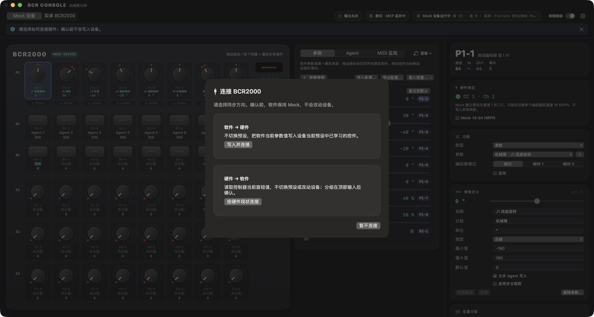
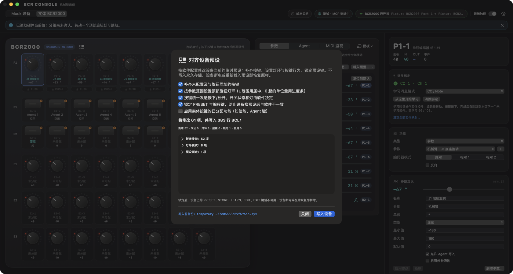

<div align="center">


# BCR Agent Console

**把 Behringer BCR2000 变成双向实体控制台的原生 macOS 应用**

转动旋钮改参数，参数再回写灯环；同一份参数状态同时开放给界面、实体硬件和 AI Agent。

[](https://github.com/NorthBoundWisdom/BCR2000Dev/actions/workflows/ci.yml)


[项目状态](#项目状态) · [快速开始](#快速开始) · [连接实体设备](#连接实体-bcr2000) · [功能](#功能) · [文档](#文档)


</div>

## 项目状态

截至 2026-11-13：

| 方面 | 状态 |
| --- | --- |
| Mock 与软件功能 | 参数、学习、预设对齐、Agent（Mock / Codex）、MCP、输出安全门、Provider 与 Surface 模拟均已实现，并有非硬件回归测试。 |
| 实体设备 | 固件 1.10、USB 模式 U-1、Preset 8，已接回开发机。身份查询、108 条 CC 快照和临时预设只读回读通过；56 个旋钮位置已实测学习，GUI 启动可读回 56/56 当前值。 |
| 连接与写入实测 | 连接确认、读硬件、暂不连接、拔插、按住拔线、受控写入与恢复已在现场通过。业务按键与锁图标只做了样本验证；Agent 按键灯、显示屏节奏和其余灯环模式仍待实测。 |
| USB 双向通讯 | 部分 Mac 需要开发签署的 DriverKit 修复才能写设备。本机已验证可用；另一台 Mac 的驱动签署仍受阻。 |
| 分发 | CI 产出 ad-hoc 签名的主程序包，未经 Apple 公证，也不含 DriverKit 修复。正式分发暂停。 |

剩余实机项（HW0–HW6）和待决策事项见 [TODO](TODO.md)；当前执行顺序见 [后续规划](PLAN.md)；
连接现场步骤见 [硬件连接实测清单](HARDWARE_CONNECT_TEST.md)。

## 亮点

| | |
| --- | --- |
| 🎛️ **108 控件虚拟面板** | 按真实面板布局呈现旋钮、按键、四位七段显示屏及右侧设备列；灯环按预设实际显示模式绘制，设备本地键的禁用/锁定状态清晰可见。 |
| 🔁 **真正的双向同步** | 软件参数是唯一事实来源：硬件输入改参数，参数决定反馈。滑块、旋钮和 Agent 写入走同一条管线。 |
| 🧪 **不接硬件也能用** | `Mock 设备` 模式下面板本身就是模拟硬件，拖动旋钮、按下按键即可体验完整流程。 |
| 🔐 **连接前先确认方向** | 已有映射时，连接前选择“按硬件现状连接”、“写入并连接”或“暂不连接”；确认前不改动设备。 |
| 🎓 **学习与显式预设对齐** | 逐控件学习、全台旋钮批量学习读取现有映射；对齐预设先备份和预览，确认后才写临时预设并回读核对，可跨重启恢复。 |
| 🤖 **Agent 槽位与 MCP 接口** | 8 个槽位可由实体按键启动或中断；可接入本机 Codex，审批必须在 Agent 页确认；本机 MCP 服务让任意客户端读写参数。 |

## 界面一览

| Agent 槽位 | MIDI 监视 |
| :---: | :---: |
|  |  |
| B1 行按键即 Agent 主操作；可在 Agent 设置中启用状态闪烁 | 区分设备输入、软件回写与 Agent 写入 |

| 专业面板：机械臂预览（手动启用） |
| :---: |
|  |
| 由 J1–J6、夹爪等软件参数驱动的姿态示意，说明硬件与软件编辑落在同一份参数状态 |

| 连接确认（隔离假设备） | 对齐预览（隔离假设备） |
| :---: | :---: |
|  |  |
| 确认同步方向前不改动设备 | 预览只读；确认后逐行写入、回读核对，可恢复原预设 |

截图从隔离实例生成并载入“机械臂示例”预置。前四张使用 Mock，连接/对齐两张使用内存假设备
（图中 `Fixture BCR2000`），仅用于展示界面，不代表硬件验证结果。只截取应用自身窗口：

```bash
python3 configs/macos_workflow.py build
python3 tools/mcp_integration.py --language zh-Hans --configuration-write --script tools/capture_readme_screenshots.py
BCR_CAPTURE_README=1 python3 tools/mcp_integration.py --language zh-Hans --connection-fixture --script tools/verify_connection_ui.py
```

需要辅助功能与屏幕录制权限；两条截图命令按顺序运行。

## 快速开始

需要 macOS 14+、Swift 6 工具链、Python 3 与 Git。

```bash
python3 configs/setup_local_project.py   # 获取并编译锁定的共享依赖，生成本机配置，启用提交钩子
python3 configs/macos_workflow.py run    # 构建并在当前终端运行，Ctrl+C 停止
```

或者构建后像普通应用一样打开：

```bash
python3 configs/macos_workflow.py build
open build/app/BCRAgentConsole.app
```

共享业务包 `SurfacePlugins` 由 `configs/surface_plugins.lock.json` 固定到完整 commit，该提交已推送到
HTTPS 远端。Setup 只用标准库和 Git 把它获取到 `build/seed/SurfacePlugins` 并编译；直接运行 `swift`
命令前先执行 `python3 configs/surface_plugins_dependency.py ensure`。构建不需要 FreeCM。
本地获取源（`SURFACE_PLUGINS_SOURCE`）、升级锁与校验规则见 [共享插件接入](docs/SHARED_PLUGINS.md)。

首次启动处于 **Mock 设备** 模式并载入中性的“默认配置”：`P1-1…P1-8` 是 8 个通用参数（0–100 %），
`B1` 行是 Agent 1–8，`B2-8` 复位参数组，全部都可以在检查器里修改。

想看完整的领域示例，在“参数”页点 **载入预置…** 选择“机械臂示例”（J1–J6、夹爪、速度、使能与复位）；
同一菜单也可回到默认配置。载入预置会替换参数与功能分配，不影响已学习的实体映射；已移除的控件会清零反馈，
运行中的外部输出会停止，需要重新确认并启动。

## 界面结构

- **顶栏**：设备源切换（`Mock 设备` / `实体 BCR2000`）、跟随触碰、输出、MCP 与 MIDI 端口状态、设置。
- **BCR2000 虚拟面板**：Mock 模式下它是模拟硬件；实体模式下它是镜像，操作即软件修改并回写硬件。
  显示屏重现预设号、数值、按键 on/oFF 与预设读写动画；硬件按键输入有按压动画。
- **工作区**：`参数`、`Agent`、`MIDI 监视`，以及按需启用的专业面板。
- **检查器**：查看和学习控件的 MIDI 身份，分配参数、Agent 主操作或复位参数组，编辑参数名称、单位、范围和默认值。
- **设置**（齿轮或 ⌘,）：Agent（Mock / Codex）、反馈调度、页面与宏、语言、配置库。
- **自适应布局**：放大窗口时面板等比放大并居中；空间足够时工作区移到面板右侧。

### 专业面板

点击工作区分页右侧的 **面板** 菜单勾选启用；选择保存在本机 `workspace-panels.json`。

| 面板 | 内容 | 默认 |
| --- | --- | --- |
| 机械臂预览 | 示例机械臂侧视 / 俯视姿态示意，由 `arm.*` 参数驱动 | 隐藏 |
| 输出 | 目标值、受限输出与实际回传读数 | 隐藏；输出运行期间始终显示 |

### 界面语言

默认跟随 macOS 首选语言，支持简体中文与 English，其他语言回退到 English。在设置中选择
“跟随系统 / 简体中文 / English”后立即生效并自动保存，不会重置设备连接、Agent 会话或参数值。
内置名称跟随语言显示，但存储、导出和 MCP 保留原值；用户命名保持原文。
macOS 系统菜单、文件面板、系统对话框按钮和系统错误描述可能保持启动时的语言，重启应用后切换。

## 连接实体 BCR2000

1. 用 USB 连接 BCR2000，建议设为 USB 模式 **U-1**（支持软件 parameter feedback）：同时按 `EDIT + STORE`
   进入 Global Setup，用 Push Encoder 1 选择 `U-1`，按 `EXIT` 保存，等待 USB 重新连接。
   见 [官方手册](https://mediadl.musictribe.com/media/PLM/data/docs/P0245/BCF2000_BCR2000_M_EN.pdf)。
2. 在顶栏切换到 `实体 BCR2000`。应用优先连接 **BCR2000 Port 1**；点击设备状态可手动选择输入/输出端口
   （含通用 USB-MIDI 接口）。手动选择的端口缺失时不会自动换路由，而是显示未连接。
3. **确认同步方向**：已有可回写映射时，启动或重连都会先保持 Mock 并弹出确认：
   - “按硬件现状连接”：读取已学习旋钮的当前值，成功后进入实体模式，读取失败则保持 Mock 并报错。回车默认选这一项。
   - “写入并连接”：把软件当前值回写到设备。
   - “暂不连接”：保留 Mock（Esc）。

   确认前不改动设备；重连不重放断线期间的旧输入。
4. **学习映射**：在面板上选中控件，在检查器点“从这里开始学习”，然后转动编码器或按下按键；
   学完自动跳到本区下一个未学习控件。也可从实体当前预设与快照一次批量学习全部 32 个旋钮（56 个逻辑位置），
   只为未分配旋钮创建参数，不猜测 CC、不改写设备预设。见 [全台旋钮批量学习](docs/CONTROL_MAP.md#全台旋钮批量学习)。
5. **对齐设备预设**：要补齐按键、设置灯环或锁定设备本地键时，从面板标题中的设备菜单选择“对齐设备预设…”。
   - 先只读读取、备份并显示修改清单；点“写入设备”才修改**临时**预设并回读核对，不写永久存储。
   - “恢复原预设”恢复对齐前的临时预设与本机映射，关闭窗口或重启 App 后仍可恢复，最多保留 5 层恢复点。
   - 实体按键的业务功能默认不启用，需在预览中或检查器里逐键明确启用。
   - 预设读写期间，MCP 与界面的设备源切换都会被拒绝。

学到的映射保存在 `~/Library/Application Support/BCRAgentConsole/hardware-map.json`，不进入仓库；
预设备份在同目录 `Backups/`，可从设备菜单打开。

**显示与已知限制**

- 灯环按预设实际显示模式绘制（当前顶部 15 灯单双点交替、下方 15 灯单点）；模式未知或未校准时显示问号。
  低端边界已校准，其余档位与其他模式待人工验收。
- 硬件分组键不报告当前组，界面显示“硬件组未确认”，转动顶部旋钮后跟随。
- 预设编号依据当前证据显示；跨重启恢复只接受经同名候选全文唯一比对证明的记录，并重新核对工作副本定义。
  未证明唯一性的手动确认仅本次连接有效；旧记录或无法证明时显示 `----`。连接后始终只读回读工作副本同步灯环，保存失败会提示。
- 读写动画的方向与速度来自现场观察，精确硬件时序仍待校准。
- 无界面服务 `BCRProviderService` 连接设备后仍自动整体回写，尚未接入确认流程（PLAN D3）。

> [!NOTE]
> 部分 Mac 上 BCR2000 的 USB OUT 管道需要 DriverKit 兼容修复才能双向工作。CI 安装包只含主程序，
> **不包含也不会自动安装该修复**；见 [构建、打包与发布](#构建打包与发布)。

## 功能

### 参数、步进与批量分配

- 按键可配置参数步进（正负与越界循环）、指定值、按顺序循环预设。
- 参数可启用步长吸附；软件与设备输入使用同一量化规则，必要时校正来源灯环。
- 编码器支持绝对、相对 1 / 相对 2 模式与相对步长，灯环始终保持绝对位置；Mock 下可用 14-bit NRPN
  验证高分辨率。实体的相对模式与 NRPN 仍待真机验证（HW3），见 [控制映射说明](docs/CONTROL_MAP.md)。
- 批量分配按控件区/行和参数组进行，先看差异再确认。
- 页面/层共享参数状态，切换时整体回写 LED；宏按顺序执行最多 64 个参数操作。

### 配置、导入导出与配置库

- 参数页可导入/导出版本化 JSON，只含参数定义与功能分配，不含实体映射、MCP 凭据或运行值；导入先校验、确认后才替换。
- 设置页的“配置库”可命名保存当前配置，确认后载入或删除（`configuration-library.json`，不含硬件映射）。
- 损坏或非法的本地文件保持原样，另存指纹命名的备份并持续提示。旧版配置显式迁移到当前版本，保存前备份。

### Agent 槽位与 Codex

8 个槽位共享一个状态机：`空闲 → 排队 → 运行 → 等待批准 → 完成`。绑定的实体按键在空闲/终态时启动、
运行/排队时中断，LED 随状态回写；可在 Agent 设置中启用状态闪烁。

默认由确定性的 Mock Agent 驱动。在设置中选择 Codex 并指定本机 `codex` 可执行文件与工作目录后，
每个槽位使用独立 Thread；默认只读。真实审批只能在 Agent 页的具体请求详情中批准或拒绝，实体按键和 MCP
都不能批准。见 [Codex 后端](docs/CODEX.md)。

### 通用 MCP 控制接口

设置窗口的 MCP 页（顶栏 MCP 状态可直达）可开启只绑定 `127.0.0.1` 的 Streamable HTTP 服务（默认端口 8787，默认关闭）。
Token 首次启用时生成并存入 Keychain；权限、逐参数 `agentWritable`、限速和调用记录都可在应用内查看。
设备源切换、未绑定控件学习、停止学习与连接确认状态查询也可经 MCP 完成。支持 MCP 2026-07-28，
兼容 2025-11-25 握手。Agent 写入经过与滑块相同的会话管线，在 MIDI 监视中标为 `AGENT`；
机械臂示例中的 `arm.enabled` 默认不可写。

```bash
export BCR_MCP_TOKEN=…                                     # 从 MCP 设置中复制
python3 tools/mcp_smoke.py --parameter general.1           # 默认配置，现代协议
python3 tools/mcp_smoke.py --parameter general.1 --legacy  # 兼容协议
python3 tools/mcp_stdio.py                                 # 给仅支持 stdio 的客户端使用的桥接
```

共享业务的统一 `surface_` 工具与 Provider 1.0 并存，见 [MCP](docs/MCP.md) 与 [新工具与权限](docs/SHARED_REMOTE_TOOLS.md)。

### 外部输出（OSC / WebSocket / ROS 2）

输出支持 OSC UDP、WebSocket JSON 与 ROS 2 rosbridge，三者共用同一安全门：软限位、单周期变化、速度、
使能边沿、300 ms 心跳/实际值期限和断线停机。心跳中断后必须先关闭再开启使能，不会自动恢复；
应用启动也不会恢复输出。

```bash
python3 tools/arm_sim.py --port 9000
```

输出需要一个开关类型的使能参数：先载入“机械臂示例”，在输出设置中选择使能参数，重新生成并检查限位草稿后应用；
在顶栏“输出”中连接本机 9000 端口并手动启动，再先关闭、后开启使能（Mock `B2-1`）。
见 [OSC 说明](docs/OSC.md) 与 [WebSocket / ROS 2 输出](docs/NETWORK_OUTPUT.md)。
连接真实机械臂前，必须先完成独立停机方案评审（TODO 第 6 节）。

### Provider 接口与 Surface 模拟

控制台、六关节参考机器人和 Ackermann 底盘可经本机 MCP/HTTP/SSE 使用。两个设备模块是明确标注
`simulation` 的最小参考实现，不提供 IK、工业驱动或碰撞资格；Agent 权限不授予设备控制权。
GUI 通过 `--robot-sim` / `--chassis-sim` 显式启用，默认不开启。

无界面的 `BCRProviderService` 不需要 GUI 或 Agent 后端。`python3 configs/package_provider.py --output <新目录>`
生成可执行文件、版本化 SDK、Schema、诊断 CLI 和示例，消费方只依赖这些产物。

可选的 `surface_control_*` 1.3 合同提供稳定 Mock profile、输入与独立显示反馈；输入、反馈和 reset 权限默认关闭，
模拟事件不算实体操作。见 [Provider API](docs/PROVIDER_API.md)、[接线说明](docs/PROVIDER_QUICKSTART.md)、
[Surface 模拟](docs/SURFACE_SIMULATION.md) 与 [ADR 0001](docs/adr/0001-provider-domain-boundaries.md)。

### 实机诊断

- 无第三方依赖的 Windows / macOS Python 灯环测试，自动学习实际 CC：见 [MIDI 诊断](docs/MIDI_DIAGNOSTICS.md)。
- 远程接线、只读预检、自动读回矩阵和 GUI 会话入口：见 [Mac 远程测试计划](docs/MAC_REMOTE_TEST_PLAN.md)；
  `tools/package_macos_diagnostics.py` 生成带校验清单的诊断包，默认不写实体 CC。

## 架构

```text
物理控件 → 硬件映射（学习得到） → 功能分配 → 参数状态（唯一事实来源）
                                                   ↓
                        LED / 灯环反馈 ← SurfaceEffect ← SurfaceSession
```

- `BCRSurfaceDomain`、`BCRAgentDomain`、`BCRRobotDomain`、`BCRChassisDomain` 各自拥有独立状态与测试，不依赖 UI、CoreMIDI 或 MCP。
- `BCRFoundation` 提供共享值合同与本地化；Codex、CoreMIDI、持久化及 MCP/HTTP 分属适配模块。
- `BCRProviderApplication` 装配可选模拟设备；GUI 与独立 `BCRProviderService` 复用同一实现。
- `BCRAgentCore` 只保留兼容导出，新领域不能依赖它；`BCRAgentConsole` 是 GUI 装配宿主。
- Agent、参考模拟器、输出安全门和示例数据来自锁定的 `SurfacePlugins`，与 XTouchCompactDev 共用同一提交；控制台引擎与硬件适配各自保留。
- `SurfaceSession` 统一执行效果、设备路由、学习、反馈丢弃计数与 MIDI 日志；`SurfaceDevice` 分别由 Mock 与 CoreMIDI 适配器实现，会话测试使用假设备。

分层设计见 [控制器映射与反馈](docs/CONTROL_MAP.md) 与 [开发设计](docs/DEVELOPMENT_DESIGN.md)。

## 构建、打包与发布

版本默认值在 `configs/app_build.json`，本机环境及签名设置放在被 Git 忽略的 `build.local.json`。

```bash
python3 configs/macos_workflow.py package                              # 当前架构：ad-hoc DMG + ZIP、SHA-256 与构建记录
python3 configs/macos_workflow.py package --architecture universal     # Apple Silicon + Intel
```

产物位于 `build/package/`。Developer ID 签名与公证见 [打包指南](docs/PACKAGING.md)。

**CI**：main / PR 与版本 tag 都使用无需证书的 ad-hoc 构建，不读取 Apple 凭据或 GitHub Secrets。
推送 `v1.2.3` 这类 tag 后，测试与 ARM / Intel 包验证通过才创建 GitHub Release；手动触发只构建不发布。
这些包未经 Apple 公证。见 [Tag 发布](docs/TAG_RELEASE_SETUP.md)。

**DriverKit USB 修复**：含修复的完整安装包需要 Apple 开发者证书与对应授权/profile。自用可用付费账号开发签署，
在已登记的 Mac 上运行；面向未登记用户公开分发还需正式 DriverKit 分发授权、Developer ID 签署和公证，目前暂停申请。
实测与维护步骤见 [DriverKit 验证](docs/DRIVERKIT_USB_PROOF.md)。

**FreeCM（可选）**：`configs/freecm.commands.jsonc` 提供 Config / Build / Run / Test / Package 入口，
`configs/source_root_workflow.py` 负责插件初始化与清理；构建本身不需要 FreeCM。

## 验证

```bash
python3 configs/format_repo.py --all --check
python3 -m compileall -q configs
python3 configs/validate_repo_commands.py .
python3 configs/check_domain_boundaries.py
python3 -m unittest discover -s Tests/BuildWorkflowTests -v
python3 configs/macos_workflow.py test     # 汇总各测试包结果，任一失败即返回非零
python3 configs/macos_workflow.py build
python3 configs/macos_workflow.py smoke
python3 configs/codex_schema.py verify     # 更新 schema 后先执行 generate
git diff --check
```

开发版可用 `--startup-smoke --render-ui` 与 `BCR_UI_SNAPSHOT_DIRECTORY` 生成自身视图的隔离渲染快照，不连接实体 MIDI。
提交约定见 [开发规范](CONTRIBUTING.md)；隔离实例的交互验收与离屏模式限制见 [原生 UI 验收](docs/UI_ACCEPTANCE.md)。
软件测试与假设备验收都不代替实机资格。

## 文档

| 主题 | 文档 |
| --- | --- |
| 计划与待办 | [TODO](TODO.md) · [后续规划](PLAN.md) · [路线图](ROADMAP.md) · [领域与接口 TODO](TODO_DOMAIN_INTERFACES.md) |
| 架构与设计 | [开发设计](docs/DEVELOPMENT_DESIGN.md) · [控制器映射与反馈](docs/CONTROL_MAP.md) · [选型 ADR](docs/adr/001-native-swift-mvp.md) · [共享插件接入](docs/SHARED_PLUGINS.md) |
| 接口 | [Provider 1.0](docs/PROVIDER_API.md) · [接线入口](docs/PROVIDER_QUICKSTART.md) · [Schema](Schemas/Provider/1.0/provider.schema.json) · [MCP](docs/MCP.md) · [surface_ 工具](docs/SHARED_REMOTE_TOOLS.md) · [Surface 模拟](docs/SURFACE_SIMULATION.md) · [Codex](docs/CODEX.md) · [OSC](docs/OSC.md) · [网络输出](docs/NETWORK_OUTPUT.md) |
| 实机与诊断 | [实机验证记录](docs/HARDWARE_VALIDATION.md) · [连接实测清单](HARDWARE_CONNECT_TEST.md) · [MIDI 诊断](docs/MIDI_DIAGNOSTICS.md) · [DriverKit 验证](docs/DRIVERKIT_USB_PROOF.md) · [Mac 远程测试](docs/MAC_REMOTE_TEST_PLAN.md) |
| 验收 | [原生 UI 验收](docs/UI_ACCEPTANCE.md) · [非硬件验收](docs/OFFLINE_ACCEPTANCE.md) · [Provider 验收](docs/PROVIDER_ACCEPTANCE.md) |
| 构建与发布 | [打包、签名与 CI](docs/PACKAGING.md) · [Tag 发布](docs/TAG_RELEASE_SETUP.md) · [图标说明](assets/README.md) |
| 协作 | [开发规范](CONTRIBUTING.md) · [Agent 指南](AGENTS.md) · [封存索引](docs/archive/README.md) |

## 许可证

本项目采用 [MIT 许可证](LICENSE)。第三方代码保留各自的版权与许可声明，见
[vendored validator 说明](configs/_vendor/README.md)。
