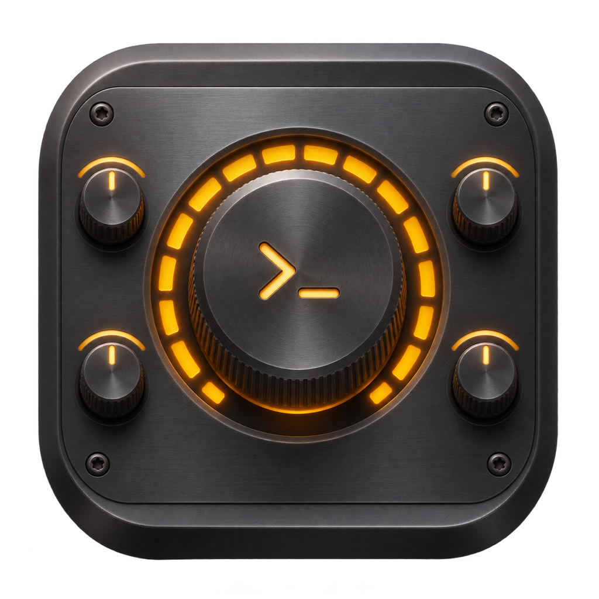
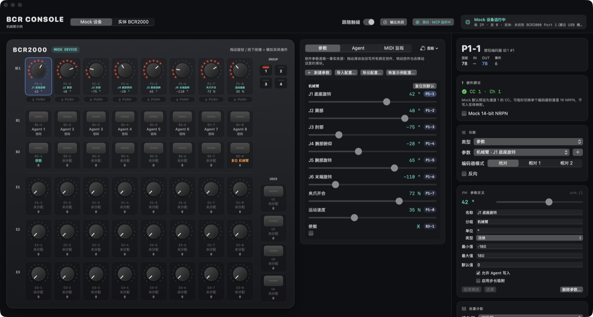
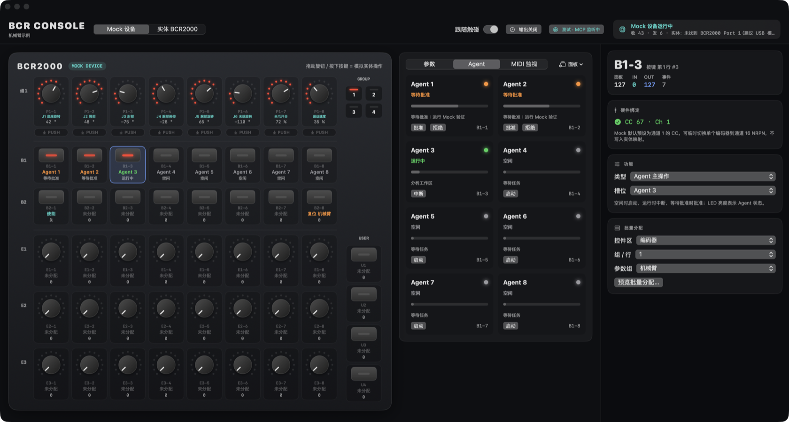
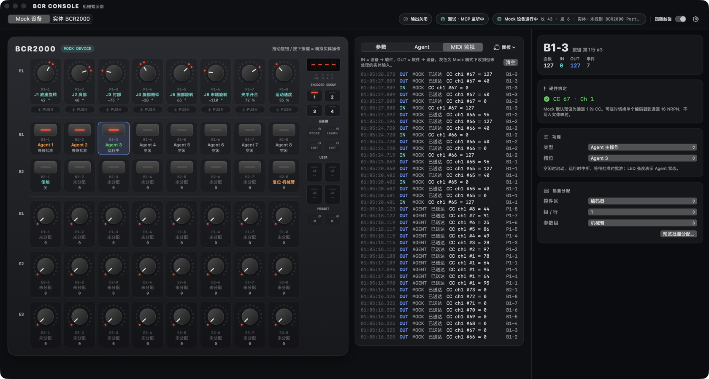
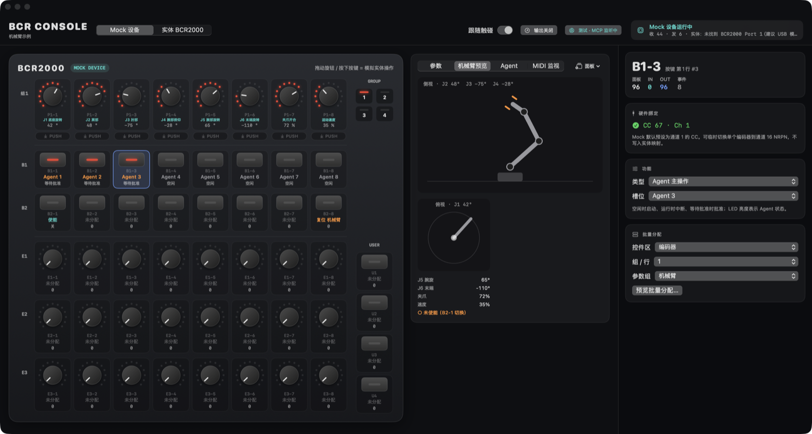

<div align="center">



# BCR Agent Console

**把 Behringer BCR2000 变成双向实体控制台的原生 macOS 应用**

转动旋钮改参数，参数再回写灯环；同一套状态同时开放给界面、实体硬件和 AI Agent。

[](https://github.com/NorthBoundWisdom/BCR2000Dev/actions/workflows/ci.yml)


[快速开始](#快速开始) · [界面一览](#界面一览) · [连接实体设备](#连接实体-bcr2000) · [功能](#功能) · [文档](#文档)



</div>

## 亮点

| | |
| --- | --- |
| 🎛️ **108 控件虚拟面板** | 按真实面板布局呈现 4 组推钮编码器、2 行按键、3 行编码器与 4 个用户按键；LED 灯环显示的就是软件回写值。 |
| 🔁 **真正的双向同步** | 软件参数是唯一事实来源：硬件输入改参数，参数决定反馈。滑块、旋钮、Agent 写入走同一条管线。 |
| 🧪 **不接硬件也能用** | `Mock 设备` 模式下面板本身就是模拟硬件，拖动旋钮、按下按键即可体验完整流程。 |
| 🎓 **不猜预设，只靠学习** | 实体映射全部来自 Quick Learn 或显式的全台旋钮批量学习，保存在本机，不改写设备预设。 |
| 🤖 **Agent 槽位与 MCP 接口** | 8 个 Agent 槽位可由实体按键启动 / 中断；真实 Codex 审批需在 Agent 页查看并确认；本机 MCP 服务让任意客户端读写参数。 |
| 🧩 **按需启用的专业面板** | 机械臂预览、OSC 输出读数默认隐藏，需要时从工作区的“面板”菜单打开。 |

## 界面一览

| Agent 槽位 | MIDI 监视 |
| :---: | :---: |
|  |  |
| B1 行按键即 Agent 主操作，LED 亮度表示状态 | 区分设备输入、软件回写与 Agent 写入 |

| 专业面板：机械臂预览（手动启用） |
| :---: |
|  |
| 由 J1–J6、夹爪等软件参数驱动的姿态示意，证明硬件与软件编辑落在同一份参数状态 |

截图取自隔离的 Mock 测试实例并载入了“机械臂示例”预置，可用下面的命令重新生成（只截取应用自身窗口）：

```bash
python3 configs/macos_workflow.py build
python3 tools/mcp_integration.py --language zh-Hans --configuration-write --script tools/capture_readme_screenshots.py
```

## 独立供应方接口与领域模块

控制台、六关节参考机器人和 Ackermann 底盘可以经本机 MCP/HTTP/SSE 使用。两个设备模块是明确标注
`simulation` 的最小参考实现，目标与实际状态分离；不提供 IK、工业驱动、厂家程序或碰撞资格。
只读状态、控制权、严格序号、控制到期/停止、故障与重置分别定义；Agent 权限不授予设备控制权。

独立服务不需要 GUI 或 Agent 后端，支持纯内存或显式的独立配置目录。生产方用
`python3 configs/package_provider.py --output <新目录>` 生成可执行文件、资源、版本化 SDK、Schema、
公开诊断 CLI 和示例。消费方只用这些产物接线，不能依赖本仓库内部 Swift 类型或开发脚本。
GUI 通过 `--robot-sim` / `--chassis-sim` 显式启用可选模块，默认不开启。

首批合同与资格边界见 [Provider API](docs/PROVIDER_API.md)、[接线说明](docs/PROVIDER_QUICKSTART.md)，
依赖与范围决定见 [ADR 0001](docs/adr/0001-provider-domain-boundaries.md)。

## 快速开始

需要 macOS 14+ 与 Swift 6 工具链；Mock Agent 依赖同源共享包 `SurfacePlugins` 的精确 `0.1.0`。
远端版本尚未发布，当前从已有并列工作副本构建，先在 shell 设置 `export SURFACE_PLUGINS_PATH=../SurfacePlugins`
（或给工作流配置 ignored `build.local.json`）。依赖、时序与旧 API 边界见 [共享插件接入](docs/SHARED_PLUGINS.md)。

```bash
python3 configs/setup_local_project.py   # 首次：生成本机配置并启用提交钩子
python3 configs/macos_workflow.py run    # 构建并在当前终端运行，Ctrl+C 停止
```

或者构建后像普通应用一样打开：

```bash
python3 configs/macos_workflow.py build
open build/app/BCRAgentConsole.app
```

首次启动处于 **Mock 设备** 模式并载入中性的“默认配置”：`P1-1…P1-8` 是 8 个通用参数（0–100 %），
`B1` 行是 Agent 1–8，`B2-8` 复位参数组。全部都可以在检查器里改掉。

想看一个完整的领域示例，在“参数”页点 **载入预置…** 选择“机械臂示例”（J1–J6、夹爪、速度、使能与复位）；
同一菜单也可随时回到默认配置。载入预置会替换参数与功能分配，不影响已学习的实体映射。
已移除的控件会清零反馈；运行中的外部输出会停止，即使重新载入同一配置也需要重新确认并启动。

### 界面语言

默认跟随 macOS 的首选语言顺序，支持简体中文与 English；其他语言回退到 English。
点击顶栏齿轮，或使用应用菜单的 **设置… / Settings…（⌘,）**，选择“跟随系统 / 简体中文 / English”。
选择自动保存，**退出并重新打开应用后生效**，使原生菜单、后台状态与界面保持一致。
已有配置、参数和分组名称保留原文；新建参数和载入内置预置时使用当前语言。
语言设置不修改 MIDI 身份、Quick Learn 映射或参数 ID。

## 界面结构

- **顶栏**：设备源切换（`Mock 设备` / `实体 BCR2000`）、跟随触碰、OSC 输出、MCP 与 MIDI 端口状态。
- **BCR2000 虚拟面板**：Mock 模式下它是模拟硬件；实体模式下它是镜像，操作即软件修改并回写硬件。
- **工作区**：`参数`（与硬件双向同步的滑块）、`Agent`（8 个槽位）、`MIDI 监视`，以及按需启用的专业面板。
- **检查器**：查看 / 学习控件的 MIDI 身份，分配参数、Agent 主操作或复位参数组，编辑参数名称、单位、范围和默认值。
- **自适应布局**：放大窗口时面板等比放大并居中；空间足够时工作区移到面板右侧。拖动顶部空白处移动窗口，双击放大 / 还原。

### 专业面板

面向特定场景的面板默认不出现在工作区，避免干扰日常使用。点击工作区分页右侧的 **面板** 菜单即可勾选启用，
再次点击取消；选择保存在本机 `workspace-panels.json`，下次启动保持不变。

| 面板 | 内容 | 默认 |
| --- | --- | --- |
| 机械臂预览 | 示例机械臂的侧视 / 俯视姿态示意，由“机械臂示例”预置的 `arm.*` 参数驱动 | 隐藏 |
| 输出 | OSC 目标值、受限输出与实际回传读数 | 隐藏；输出运行期间始终显示 |

OSC 输出运行时“输出”面板会自动出现，确保安全门的实时读数不会被藏在菜单后面。

## 连接实体 BCR2000

1. 用 USB 连接 BCR2000，并建议设为 USB 模式 **U-1**：同时按 `EDIT + STORE` 进入 Global Setup，
   用 Push Encoder 1 选择 `U-1`，按 `EXIT` 保存，等待 USB 重新连接，再重启 App 测试软件回写。
   U-1 支持软件 parameter feedback，设置说明见
   [官方手册](https://mediadl.musictribe.com/media/PLM/data/docs/P0245/BCF2000_BCR2000_M_EN.pdf)。
2. 在顶栏切换到 `实体 BCR2000`。应用优先连接 **BCR2000 Port 1**；点击右上角设备状态可手动选择 MIDI
   输入 / 输出端口（含通用 USB-MIDI 接口）。手动选择的端口缺失时不会自动换路由，而是显示未连接。
3. **学习映射**：在面板上选中控件，在检查器点“从这里开始学习”，然后转动编码器或按下按键。
   学完自动跳到本区下一个未学习控件，可以连续扫过整排。
4. 需要一次学完所有旋钮时，可从实体当前预设与快照显式批量学习：32 个实体旋钮对应 56 个逻辑位置，
   只为未分配旋钮创建参数，不猜测 CC、不改写设备预设。见
   [全台旋钮批量学习](docs/CONTROL_MAP.md#全台旋钮批量学习)。

学到的映射保存在 `~/Library/Application Support/BCRAgentConsole/hardware-map.json`，不会进入仓库。
设备断线期间的反馈只计数，连接恢复时回写当前软件快照。

> [!NOTE]
> 部分 Mac 上 BCR2000 的 USB OUT 管道需要 DriverKit 兼容修复才能双向工作。CI 安装包只含主程序，
> **不包含也不会自动安装该修复**；详情见 [构建、打包与发布](#构建打包与发布)。

## 功能

### 参数、步进与批量分配

- 按键可配置参数步进（正负与越界循环）、指定值、按顺序循环预设。
- 参数可启用步长吸附；软件与设备输入使用同一量化规则，必要时校正来源灯环。
- 编码器支持绝对、相对 1 / 相对 2 模式与相对步长，灯环始终保持绝对位置；Mock 下可用 14-bit NRPN
  验证高分辨率。实体的相对模式与 NRPN 编码仍待真机验证，见 [控制映射说明](docs/CONTROL_MAP.md)。
- 批量分配选择控件区 / 行和参数组，先看差异再确认；预览期间配置变化则需重新预览。

### 配置导入与导出

参数工作区可导入 / 导出版本化 JSON，仅包含参数定义与功能分配，不含实体映射、MCP 凭据或运行值。
导入先校验、确认后才替换；失败时保留当前配置。加载到非法的本地配置会保留原文件并另存指纹命名的备份，
同时显示持续提示。当前功能配置为 v7、硬件映射为 v4，读取旧版会显示迁移信息并在保存前备份。
详见 [配置恢复规则](docs/CONTROL_MAP.md) 与 [WP4 验收记录](docs/archive/WP4_HANDOFF.md)。

### Agent 槽位

8 个槽位共享一个状态机：`空闲 → 排队 → 运行 → 等待批准 → 完成`。绑定的实体按键在空闲 / 终态时启动、
运行 / 排队时中断，LED 随状态回写。Mock 等待批准时沿用演示批准操作；真实 Codex 等待审批时，实体按键仅提示到 Agent 页查看，
批准必须在详情页明确确认；请求不自动过期，同槽位并发请求逐笔处理，失败可重试。默认由确定性的 Mock Agent 驱动；
真实 `codex app-server` 接入见 [TODO](TODO.md)。

### 通用 MCP 控制接口

顶栏 MCP 设置可开启仅绑定 `127.0.0.1` 的 Streamable HTTP 服务（默认端口 8787，默认关闭）。
Token 首次启用时生成并存入 Keychain；权限、逐参数 `agentWritable`、限速和调用记录都可在应用内查看。
设备源切换、未绑定控件 Quick Learn、停止学习和关闭配置写权限也可通过 MCP 完成。
程序化启动的显式凭据管道与权限边界见 [MCP 文档](docs/MCP.md)，无需界面自动化。
支持 MCP 2026-07-28 并兼容 2025-11-25 握手，不依赖特定厂商客户端。Agent 写入经过与滑块相同的会话管线，
在 MIDI 监视中标为 `AGENT`；机械臂示例中的 `arm.enabled` 默认不可写。

```bash
export BCR_MCP_TOKEN=…                                  # 从 MCP 设置中复制
python3 tools/mcp_smoke.py --parameter general.1           # 默认配置，现代协议
python3 tools/mcp_smoke.py --parameter general.1 --legacy  # 兼容协议
```

`--parameter` 缺省为机械臂示例的 `arm.j1`；探针结束后会恢复该参数原值。

协议、工具 schema 与权限见 [MCP 文档](docs/MCP.md)。

### OSC 仿真输出

```bash
python3 tools/arm_sim.py --port 9000
```

输出需要一个开关类型的使能参数，默认配置没有；先载入“机械臂示例”预置（或自建一个开关参数）。
切换配置后，在输出设置中选择使能参数，点“重新生成限位草稿…”并检查后应用；原有限位不会自动替换。
在顶栏“输出”中连接本机 9000 端口，检查限位后手动启动，再先关闭、后开启使能（Mock `B2-1`）。
应用启动不会自动恢复输出；所有写入来源都经过同一安全门。启用“输出”面板可查看目标、限速输出和实际回传。
协议、安全门与 LED 来源选择见 [OSC 说明](docs/OSC.md)。

### 实机诊断

- 无第三方依赖的 Windows / macOS Python 五段灯环测试，自动学习实际 CC：见 [MIDI 诊断](docs/MIDI_DIAGNOSTICS.md)。
- 远程接线、只读预检、自动读回矩阵和 GUI 会话入口：见 [Mac 远程测试计划](docs/MAC_REMOTE_TEST_PLAN.md)；
  `tools/package_macos_diagnostics.py` 生成带校验清单的通用诊断包，默认不写实体 CC。

## 架构

```text
物理控件 → 硬件映射（学习得到） → 功能分配 → 参数状态（唯一事实来源）
                                                   ↓
                        LED / 灯环反馈 ← SurfaceEffect ← SurfaceSession
```

- `BCRSurfaceDomain`、`BCRAgentDomain`、`BCRRobotDomain`、`BCRChassisDomain` 分别拥有独立状态与测试，领域不依赖 UI、CoreMIDI 或 MCP。
- `BCRFoundation` 提供共享值合同与本地化；具体 Agent 后端、CoreMIDI、持久化及 MCP/HTTP 分属适配模块。
- `BCRProviderApplication` 装配可选模拟设备应用服务；GUI 和独立 `BCRProviderService` 复用同一实现。
- `BCRAgentCore` 只保留兼容导出；新领域不能依赖它。`BCRAgentConsole` 是 GUI 装配宿主。
- `SurfaceSession` 统一执行效果、设备路由、学习、反馈丢弃计数与 MIDI 日志；`SurfaceDevice`
  由 Mock 适配器和 CoreMIDI 适配器分别实现，会话测试使用假设备，无需真机。

分层设计见 [控制器映射与反馈](docs/CONTROL_MAP.md) 与 [开发设计](docs/DEVELOPMENT_DESIGN.md)。

## 构建、打包与发布

版本默认值在 `configs/app_build.json`，本机环境及签名设置放在被 Git 忽略的 `build.local.json`。

```bash
# 当前机器架构：ad-hoc 签名的 DMG + ZIP、SHA-256 校验和与构建记录
python3 configs/macos_workflow.py package

# 同时支持 Apple Silicon 和 Intel 的 Universal 安装包
python3 configs/macos_workflow.py package --architecture universal
```

产物位于 `build/package/`。Developer ID 签名、公证与最终安装包检查见 [打包指南](docs/PACKAGING.md)。

**CI**：普通 CI（main / PR）与版本 tag CI 都使用无需证书的 ad-hoc 构建，不读取任何 Apple 凭据或
GitHub Secrets。推送如 `v1.2.3` 的版本 tag 后，测试与 ARM / Intel 包验证通过才创建 GitHub Release，
上传 Universal ZIP / DMG、构建记录和 SHA-256；手动触发只构建、不发布。这些包未经 Apple 公证。
流程见 [Tag 发布](docs/TAG_RELEASE_SETUP.md)。

**DriverKit USB 修复**：CI 安装包只含 `BCRAgentConsole.app`。含 DriverKit USB 修复的完整安装包需要
Apple 开发者证书与对应授权 / profile 签署——自用可用付费账号开发签署并在已登记的 Mac 上运行；
面向未登记用户公开分发还需正式 DriverKit USB 分发授权、Developer ID 签署和公证，目前不申请。
已在本机安装的开发签署修复可继续使用。实机结果见 [DriverKit 验证](docs/DRIVERKIT_USB_PROOF.md)。

**FreeCM 插件（可选）**：`configs/freecm.commands.jsonc` 保留 Config / Build / Run / Test / Package 入口，
`configs/source_root_workflow.py` 保留插件初始化、更新和构建清理入口。构建本身不需要 FreeCM。

## 验证

```bash
python3 configs/format_repo.py --all --check
python3 -m compileall -q configs
python3 configs/validate_repo_commands.py .
python3 -m unittest discover -s Tests/BuildWorkflowTests -v
python3 configs/macos_workflow.py test
python3 configs/macos_workflow.py build
python3 configs/macos_workflow.py smoke
python3 configs/codex_schema.py verify   # 更新 schema 后先执行 generate
git diff --check
```

提交约定与自动格式化见 [开发规范](CONTRIBUTING.md)；六项隔离 Mock 的交互验收命令与覆盖范围见
[原生 UI 验收](docs/UI_ACCEPTANCE.md)。

## 文档

| 主题 | 文档 |
| --- | --- |
| 架构与设计 | [开发设计](docs/DEVELOPMENT_DESIGN.md) · [控制器映射与反馈](docs/CONTROL_MAP.md) · [选型 ADR](docs/adr/001-native-swift-mvp.md) |
| 接口 | [Provider 1.0](docs/PROVIDER_API.md) · [公开接线入口](docs/PROVIDER_QUICKSTART.md) · [Schema](Schemas/Provider/1.0/provider.schema.json) · [本轮验收](docs/PROVIDER_ACCEPTANCE.md) · [MCP](docs/MCP.md) · [OSC](docs/OSC.md) |
| 实机与诊断 | [实机验证记录](docs/HARDWARE_VALIDATION.md) · [MIDI 诊断](docs/MIDI_DIAGNOSTICS.md) · [DriverKit 验证](docs/DRIVERKIT_USB_PROOF.md) · [窗口拖曳分析](docs/WINDOW_DRAG_ANALYSIS.md) |
| 构建与发布 | [打包、签名与 CI 发布](docs/PACKAGING.md) · [Tag 发布](docs/TAG_RELEASE_SETUP.md) · [图标说明](assets/README.md) |
| 协作 | [开发规范](CONTRIBUTING.md) · [路线图](ROADMAP.md) · [TODO](TODO.md) · [Agent 指南](AGENTS.md) |

历史工作包与一次性交接见 [封存索引](docs/archive/README.md)。后续工作的顺序与状态以 [TODO](TODO.md) 为准。

Codex 进程管理已补基础生命週期回归：未启动及启动失败后的读取返回 EOF，失败后可重试；
标准输入输出、重复启动拒绝、停止释放等待读取与重新启动均有测试。App 默认使用 Mock，可在设置中明确连接 Codex；见 [Codex 后端](docs/CODEX.md)。

设置页的“配置库”可命名保存当前参数与分配，确认后载入或删除；文件存放在应用支持目录的
`configuration-library.json`，不含硬件映射。损坏库文件保持原样并显示错误。

仅支持 stdio 的 MCP 客户端可运行 `python3 tools/mcp_stdio.py`，通过环境变量 `BCR_MCP_TOKEN`
提供凭据，默认连接 `http://127.0.0.1:8787/mcp`；标准输出只包含协议响应。

设置页现在提供 Agent（Mock / Codex）、反馈调度、页面与宏、语言、配置库。
页面/层共享参数状态，切换时整体回写 LED；宏按顺序执行最多 64 个参数操作。
配置 v1–v6 显式迁移为 v7（显式外部写保护），保留旧文件备份与已学 MIDI 身份。

更多说明：[Codex 后端](docs/CODEX.md)、[WebSocket / ROS 2 输出](docs/NETWORK_OUTPUT.md)、
[MCP 权限及 SSE](docs/MCP.md)。开发版可用 `--startup-smoke --render-ui` 和
`BCR_UI_SNAPSHOT_DIRECTORY` 生成自身视图的隔离渲染快照，不连接实体 MIDI。

## 许可证

本项目采用 [MIT 许可证](LICENSE)。第三方代码保留各自的版权与许可声明，见
[vendored validator 说明](configs/_vendor/README.md)。
