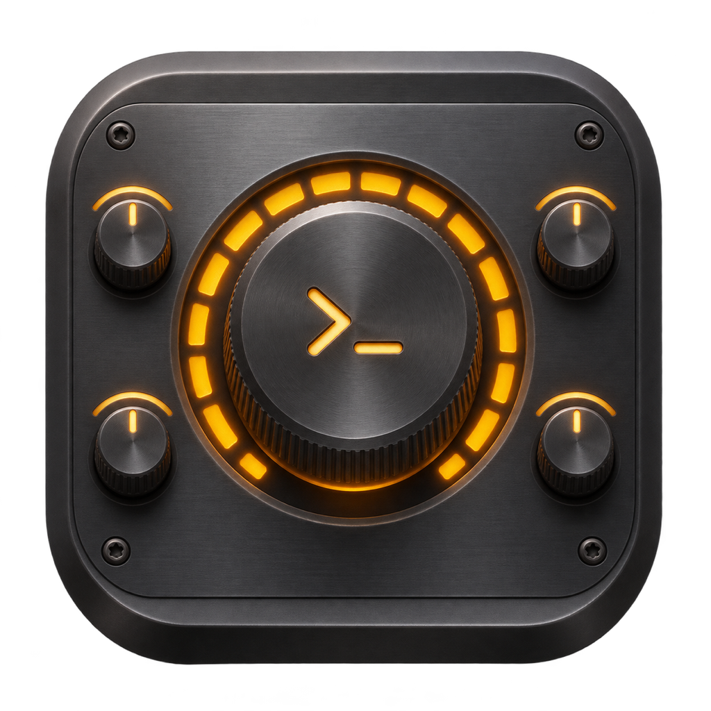
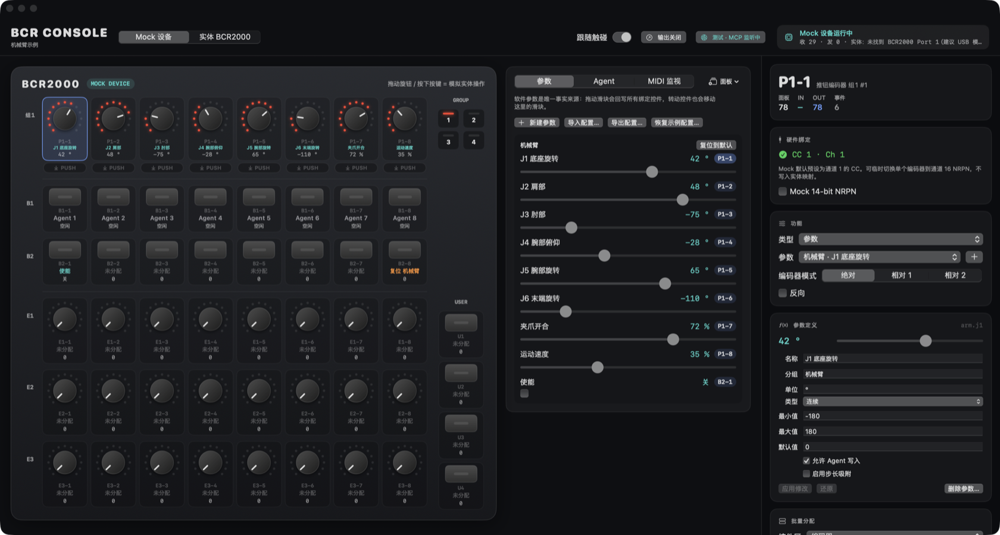
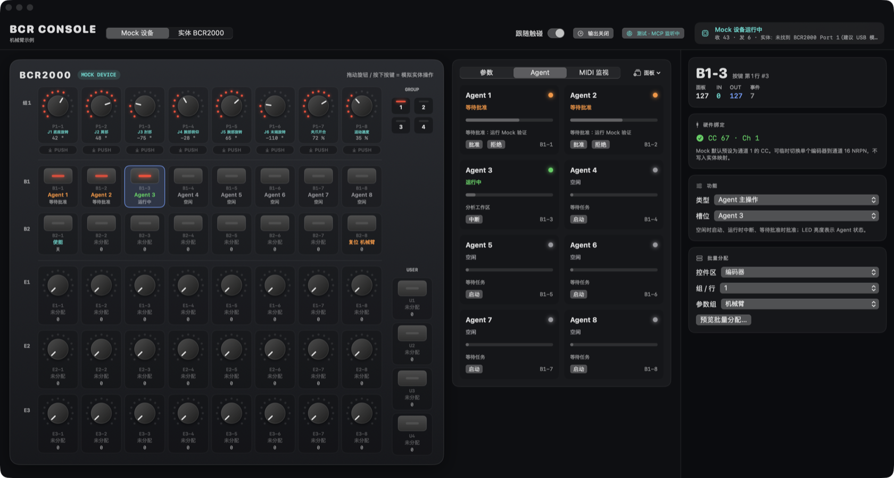
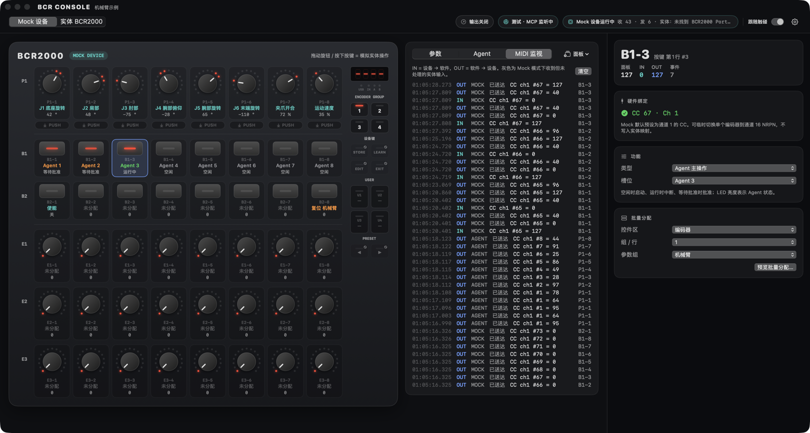
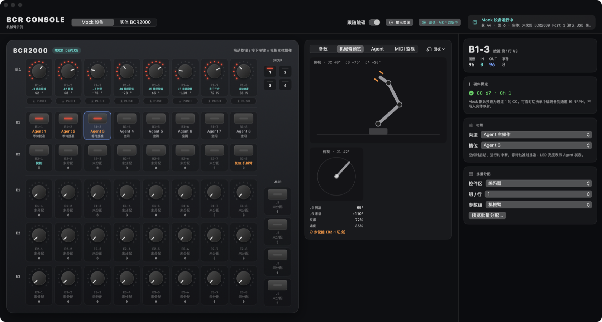
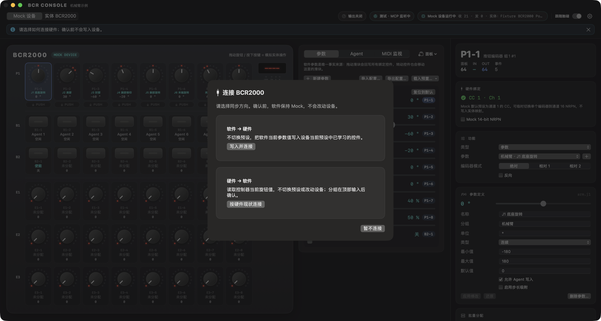
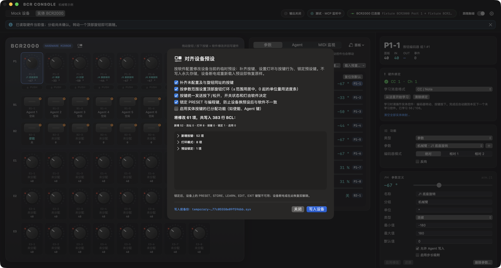

<div align="center">



# BCR Agent Console

**A native macOS app that turns the Behringer BCR2000 into a bidirectional physical console**

Turn a knob to change a parameter, then send its value back to the LED ring. The UI, physical hardware, and AI agents share the same parameter state.

[中文](README.zh-CN.md)

[](https://github.com/NorthBoundWisdom/BCR2000Dev/actions/workflows/ci.yml)


[Project status](#project-status) · [Quick start](#quick-start) · [Connect hardware](#connect-a-physical-bcr2000) · [Features](#features) · [Documentation](#documentation)



</div>

## Project status

As of 2026-11-16 (software); hardware rows retain their previously recorded qualification scope:

| Area | Status |
| --- | --- |
| Mock and software features | Parameters, Undo/Redo, scenes, color tags, macro toggle and per-step results, JSONL recording/offline review, input coverage, learning, preset alignment, agents (Mock / Codex), MCP, output safety gates, Provider, and Surface simulation have non-hardware regression tests. |
| Languages and portable core | English, Simplified Chinese and Traditional Chinese; Linux CI executes the pure Foundation/domain/application slice. Native GUI, MIDI and HTTP hosts remain macOS-only. |
| Physical device | Firmware 1.10, USB mode U-1, Preset 8; connected to the development Mac again. Identity queries, a 108-CC snapshot, and read-only temporary-preset readback passed. All 56 logical knob positions have been learned on hardware, and GUI startup reads back 56/56 current values. |
| Connection and write validation | Connection confirmation, reading hardware, deferring connection, unplug/replug, unplugging while holding a button, controlled writes, and restoration passed on site. Assigned button actions and lock icons have only been spot-checked; agent button LEDs, display timing, and remaining LED ring modes still need hardware validation. |
| Bidirectional USB communication | Some Macs need a development-signed DriverKit fix to write to the device. It works on this Mac; driver signing on another Mac remains blocked. |
| Distribution | CI produces an ad-hoc-signed main app package without Apple notarization or the DriverKit fix. Public distribution is on hold. |

See [TODO](TODO.md) for remaining hardware checks (HW0–HW6) and pending decisions, [Next steps](PLAN.md) for the current execution order,
and the [hardware connection checklist](HARDWARE_CONNECT_TEST.md) for on-site procedures.

## Highlights

| | |
| --- | --- |
| 🎛️ **108-control virtual panel** | Knobs, buttons, a four-digit seven-segment display, and the right-hand device controls follow the physical layout. LED rings reflect the preset's actual display modes, with clear disabled/locked states for device-local buttons. |
| 🔁 **Bidirectional synchronization** | Software parameters are the source of truth: hardware input changes parameters, and parameters determine feedback. Sliders, knobs, and agent writes use the same pipeline. |
| 🧪 **Works without hardware** | In Mock Device mode, the panel itself acts as simulated hardware. Drag knobs and press buttons to try the full workflow. |
| 🔐 **Confirm synchronization before connecting** | With an existing mapping, choose to read hardware, write software values and connect, or defer connection. The device stays unchanged until confirmation. |
| 🎓 **Learning and explicit preset alignment** | Learn individual controls or read existing mappings with bulk knob learning. Preset alignment starts with a backup and preview; only confirmation writes the temporary preset and verifies it by readback. Restoration survives app restarts. |
| 🤖 **Agent slots and MCP** | Eight slots can be started or interrupted by physical buttons. Connect a local Codex backend, review approvals on the Agent page, or use the local MCP service to read and write parameters from any client. |

## Interface tour

| Agent slots | MIDI monitor |
| :---: | :---: |
|  |  |
| B1-row buttons perform the primary agent action; state blinking is available in Agent settings | Distinguishes device input, software feedback, and agent writes |

| Optional panel: arm preview (enabled manually) |
| :---: |
|  |
| A pose preview driven by J1–J6, gripper, and other software parameters, illustrating how hardware and software edits share one parameter state |

| Connection confirmation (isolated fake device) | Alignment preview (isolated fake device) |
| :---: | :---: |
|  |  |
| The device stays unchanged until the synchronization direction is confirmed | Preview is read-only; confirmation writes line by line and verifies readback, with restoration available |

Screenshots use isolated instances with the Arm Example preset. The first four use Mock; the connection and alignment screenshots use an in-memory fake device
(named `Fixture BCR2000`). They demonstrate the UI and do not constitute hardware validation. Only the app's own window is captured:

```bash
python3 configs/macos_workflow.py build
python3 tools/mcp_integration.py --language zh-Hans --configuration-write --script tools/capture_readme_screenshots.py
BCR_CAPTURE_README=1 python3 tools/mcp_integration.py --language zh-Hans --connection-fixture --script tools/verify_connection_ui.py
```

Accessibility and Screen Recording permissions are required. Run the two capture commands in order. The current screenshots show the Chinese UI.

## Quick start

Requires macOS 14+, a Swift 6 toolchain, Python 3, and Git.

```bash
python3 configs/setup_local_project.py   # Fetch and compile the locked shared dependency, create local config, enable commit hooks
python3 configs/macos_workflow.py run    # Build and run in this terminal; stop with Ctrl+C
```

Or build and open it like a regular app:

```bash
python3 configs/macos_workflow.py build
open build/app/BCRAgentConsole.app
```

The shared business package `SurfacePlugins` is pinned to a full commit in `configs/surface_plugins.lock.json`; that commit is available on the
HTTPS remote. Setup uses only the standard library and Git to fetch it into `build/seed/SurfacePlugins` and compile it. Before running `swift`
commands directly, run `python3 configs/surface_plugins_dependency.py ensure`. FreeCM is not required to build.
See [shared plugin integration](docs/SHARED_PLUGINS.md) for local acquisition sources (`SURFACE_PLUGINS_SOURCE`), lock upgrades, and validation rules.

On first launch, the app uses **Mock Device** mode and a neutral default configuration: `P1-1…P1-8` control eight generic parameters (0–100%),
the `B1` row controls Agents 1–8, and `B2-8` resets the parameter group. All assignments can be edited in the inspector.

For a complete domain example, use **Load Preset…** on the Parameters page and choose Arm Example (J1–J6, gripper, speed, enable, and reset).
The same menu restores the default configuration. Loading a preset replaces parameters and function assignments while preserving learned hardware mappings.
Feedback for removed controls is cleared, and active external output stops; it must be confirmed and started again.

## Interface layout

- **Top bar**: device source (Mock Device / Physical BCR2000), follow touch, output, MCP and MIDI port status, and settings.
- **Virtual BCR2000 panel**: simulated hardware in Mock mode; a mirror in physical mode, where interaction makes software changes and sends feedback to hardware.
  The display reproduces preset numbers, values, button on/oFF states, and preset read/write animations. Hardware button input triggers press animations.
- **Workspace**: Parameters, Agent, MIDI Monitor, and optional specialist panels.
- **Inspector**: view and learn a control's MIDI identity; assign parameters, agent primary actions, or group resets; edit parameter names, units, ranges, and defaults.
- **Settings** (gear or ⌘,): a fixed-size window with six pages: General (language and configuration library), Device (MIDI ports and feedback scheduling),
  Output, MCP, Agent (Mock / Codex), and Pages & Macros. Top-bar output / MCP / MIDI status opens the corresponding page.
  Device, feedback scheduling, output, and MCP form changes take effect after Apply; pending changes are indicated beside the button and discarded when switching pages.
  Language, the MCP service toggle, and LED ring display settings take effect immediately. Agent changes apply to the current run; Save Settings preserves them across restarts.
- **Adaptive layout**: the panel scales proportionally and stays centered as the window grows; the workspace moves to its right when space permits.

### Optional panels

Enable panels from the **Panels** menu to the right of the workspace tabs. Selections are saved locally in `workspace-panels.json`.

| Panel | Contents | Default |
| --- | --- | --- |
| Arm preview | Side and top views of the example arm, driven by `arm.*` parameters | Hidden |
| Output | Targets, limited output, and actual feedback values | Hidden; always visible while output is running |
| Offline captures | JSONL integrity review and isolated Mock input replay | Hidden |
| Input coverage | Passive observations for all 108 controls and fingerprinted export | Hidden |

Parameter value changes support Undo/Redo (⌘Z / ⇧⌘Z) from the Edit menu and Parameters workspace. Continuous input is grouped within 400 ms; local and MCP batches are undoable, with current parameter protections and output safety still applied.

Named scenes in the Parameters workspace save and recall parameter values as one undoable batch. Scenes travel with exported profiles and the configuration library; missing parameters are reported and current protections still apply.

Parameters also support eight software color tags and per-group panel highlighting. Tags persist with profiles; highlights are session-only and send no MIDI.

The MIDI monitor can record versioned JSONL evidence to Application Support/Captures. Background writes are bounded and failures are visible; recording does not change MIDI traffic. SysEx payloads are redacted to length and SHA-256.

Enable Offline captures from Panels to inspect JSONL integrity and replay inputs in a fully isolated Mock session. Step/run/pause/reset never open MIDI ports or send recorded outputs. Foreign-device samples expose common review fields and are explicitly refused for replay.

Input coverage is a passive optional workspace for all 108 logical controls. It separates hardware and Mock observations, flags mapping mismatches, and exports a fingerprinted review without sending MIDI or learning controls.

Macros support set, step, toggle and group reset, with applied/rejected results for each step and one Undo entry for the whole execution. See [configuration versions](docs/CONTROL_MAP.md#配置文件版本) and [native identifiers](docs/UI_IDENTIFIERS.md).

### Interface language

The app follows the preferred macOS language by default, supports Simplified Chinese, Traditional Chinese, and English, and falls back to English for other languages.
Selecting Follow System, Simplified Chinese, Traditional Chinese, or English in Settings takes effect immediately and saves automatically without resetting device connections,
agent sessions, or parameter values. Built-in names follow the display language while storage, exports, and MCP retain their original values; user-defined names remain unchanged.
macOS system menus, file panels, system dialog buttons, and system error descriptions may retain the launch language until the app restarts.

## Connect a physical BCR2000

1. Connect the BCR2000 over USB. **U-1** USB mode is recommended for software parameter feedback: press `EDIT + STORE` together
   to enter Global Setup, use Push Encoder 1 to select `U-1`, press `EXIT` to save, and wait for USB to reconnect.
   See the [official manual](https://mediadl.musictribe.com/media/PLM/data/docs/P0245/BCF2000_BCR2000_M_EN.pdf).
2. Select Physical BCR2000 in the top bar. The app prefers **BCR2000 Port 1**. Click device status to choose input/output ports manually
   (including generic USB-MIDI interfaces). If a manually selected port is missing, the app shows a disconnected state rather than rerouting automatically.
3. **Confirm synchronization direction**: when a feedback-capable mapping exists, startup and reconnection keep Mock active and request confirmation:
   - Connect using hardware values: read the current values of learned knobs, then enter physical mode. If reading fails, remain in Mock and show an error. This is the Return-key default.
     Knob values and the preset stay unchanged. After connecting, only button LEDs are refreshed from software state (such as agents), because the device cannot report those LEDs.
   - Write and connect: send current software values to the device.
   - Defer connection: stay in Mock (Esc).

   The device stays unchanged until confirmation. Reconnection does not replay stale input from the disconnected period.
4. **Learn mappings**: select a control on the panel, start learning from the inspector, then turn the encoder or press the button.
   Learning advances automatically to the next unlearned control in that section. Bulk learning can read all 32 physical knobs (56 logical positions)
   from the current hardware preset and snapshot, creating parameters only for unassigned knobs without guessing CCs or rewriting the device preset.
   See [bulk knob learning](docs/CONTROL_MAP.md#%E5%85%A8%E5%8F%B0%E6%97%8B%E9%92%AE%E6%89%B9%E9%87%8F%E5%AD%A6%E4%B9%A0).
5. **Align the device preset**: to configure buttons, LED rings, or locks on device-local buttons, choose Align Device Preset… from the device menu in the panel header.
   - First read, back up, and preview the changes. Only Write to Device changes the **temporary** preset and verifies readback; permanent storage is untouched.
   - Restore Original Preset restores the previous temporary preset and local mapping, even after closing the window or restarting the app. Up to five restore points are retained.
   - Assigned actions for physical buttons are disabled by default and must be explicitly enabled per button in the preview or inspector.
   - Device source changes from MCP or the UI are rejected during preset reads and writes.

Learned mappings are stored in `~/Library/Application Support/BCRAgentConsole/hardware-map.json` and stay out of the repository.
Preset backups live in `Backups/` under the same directory, accessible from the device menu.

**Display behavior and known limitations**

- LED rings use the preset's actual display mode (currently alternating single/dual dots across 15 LEDs on the top row, and single dots across 15 LEDs below).
  Unknown or uncalibrated modes show a question mark. Low-end boundaries are calibrated; other positions and modes still need manual validation.
- Hardware group buttons do not report the current group. The UI shows an unconfirmed hardware group until a top-row knob is turned.
- Preset numbers reflect the available evidence. Restoration across restarts accepts only records proven unique by full-definition comparison of same-name candidates,
  then rechecks the working-copy definition. Manual confirmation without uniqueness proof lasts only for the current connection; old or unproven records show `----`.
  After connecting, a read-only working-copy readback always synchronizes LED rings; save failures remain visible.
- Read/write animation direction and speed follow on-site observations; exact hardware timing still needs calibration.
- The headless `BCRProviderService` still sends a full software snapshot automatically after connecting; it does not yet use the confirmation flow (PLAN D3).

> [!NOTE]
> On some Macs, the BCR2000 USB OUT pipe needs a DriverKit compatibility fix for bidirectional operation. CI packages contain only the main app and
> **neither include nor automatically install this fix**. See [Build, package, and release](#build-package-and-release).

## Features

### Parameters, stepping, and bulk assignment

- Buttons support parameter stepping (positive/negative, with wraparound), setting a specific value, and cycling through preset values.
- Parameters can snap to a step size. Software and device input use the same quantization rules, correcting the source LED ring when needed.
- Encoders support absolute, Relative 1 / Relative 2 modes, and relative step sizes, while LED rings retain absolute positions. Mock supports 14-bit NRPN
  for high-resolution validation. Physical relative modes and NRPN still need hardware validation (HW3); see [control mapping](docs/CONTROL_MAP.md).
- Bulk assignment works by control section/row and parameter group, with a difference preview before confirmation.
- Pages/layers share parameter state and refresh all LEDs on switching; macros execute up to 64 parameter operations in sequence.

### Configuration, import/export, and library

- The Parameters page imports/exports versioned JSON containing parameter definitions and function assignments, without hardware mappings, MCP credentials, or runtime values. Imports are validated and require confirmation before replacement.
- The configuration library in Settings saves named configurations, with confirmation before loading or deleting (`configuration-library.json`, without hardware mappings).
- Corrupt or invalid local files remain intact, with fingerprint-named backups and persistent warnings. Older configurations are explicitly migrated and backed up before saving.

### Agent slots and Codex

Eight slots share a state machine: `Idle → Queued → Running → Awaiting Approval → Completed`. Assigned physical buttons start idle/terminal slots
and interrupt running/queued slots. LEDs follow agent state; optional state blinking is available in Agent settings.

A deterministic Mock Agent is the default. Select Codex in Settings and specify a local `codex` executable and working directory to give each slot
an independent thread; access is read-only by default. Real approvals must be accepted or rejected in the specific request details on the Agent page.
Physical buttons and MCP cannot approve requests. See the [Codex backend](docs/CODEX.md).

### General-purpose MCP control

The MCP Settings page (also accessible from top-bar MCP status) enables a Streamable HTTP service bound only to `127.0.0.1` (default port 8787, disabled by default).
A token is generated on first activation and stored in Keychain. Permissions, per-parameter `agentWritable` flags, rate limits, and call logs are visible in the app.
MCP also supports device source changes, learning unbound controls, stopping learning, and querying connection confirmation state. It supports MCP 2026-07-28
with 2025-11-25 handshake compatibility. Agent writes use the same session pipeline as sliders and appear as `AGENT` in the MIDI monitor.
The Arm Example's `arm.enabled` parameter is not writable by default.

```bash
export BCR_MCP_TOKEN=…                                     # Copy from MCP Settings
python3 tools/mcp_smoke.py --parameter general.1           # Default configuration, modern protocol
python3 tools/mcp_smoke.py --parameter general.1 --legacy  # Compatibility protocol
python3 tools/mcp_stdio.py                                 # Bridge for stdio-only clients
```

The shared business modules' unified `surface_` tools coexist with Provider 1.0. See [MCP](docs/MCP.md) and [tools and permissions](docs/SHARED_REMOTE_TOOLS.md).

### External output (OSC / WebSocket / ROS 2)

OSC UDP, WebSocket JSON, and ROS 2 rosbridge share one safety gate: soft limits, per-cycle change limits, speed limits,
enable edges, 300 ms heartbeat/actual-value deadlines, and shutdown on disconnection. After heartbeat loss, enable must be turned off and on again;
output never resumes automatically, including after app startup.

```bash
python3 tools/arm_sim.py --port 9000
```

Output requires a toggle-type enable parameter. Load Arm Example, select the enable parameter in Output settings, regenerate and review the limit draft, then apply it.
Connect to local port 9000 from top-bar Output and start manually, then turn enable off and on (Mock `B2-1`).
See [OSC](docs/OSC.md) and [WebSocket / ROS 2 output](docs/NETWORK_OUTPUT.md).
Before connecting a real robot arm, complete a separate shutdown-plan review (TODO section 6).

### Provider interfaces and Surface simulation

The console, six-joint reference robot, and Ackermann chassis are available through local MCP/HTTP/SSE. Both device modules are minimal reference implementations
explicitly marked `simulation`; they provide no IK, industrial drivers, or collision qualification. Agent permissions do not grant device control.
The GUI enables them explicitly with `--robot-sim` / `--chassis-sim`; both are off by default.

The headless `BCRProviderService` requires neither a GUI nor an agent backend. `python3 configs/package_provider.py --output <new-directory>`
packages the executable, versioned SDK, schemas, diagnostic CLI, and examples. Consumers depend only on these artifacts.

The optional `surface_control_*` 1.3 contract provides stable Mock profiles, input, and independent display feedback. Input, feedback, and reset permissions are disabled by default;
simulated events do not count as physical operation. See [Provider API](docs/PROVIDER_API.md), [integration quick start](docs/PROVIDER_QUICKSTART.md),
[Surface simulation](docs/SURFACE_SIMULATION.md), and [ADR 0001](docs/adr/0001-provider-domain-boundaries.md).

### Hardware diagnostics

- Dependency-free Windows / macOS Python LED ring tests that learn actual CCs automatically: see [MIDI diagnostics](docs/MIDI_DIAGNOSTICS.md).
- Remote connection, read-only preflight, automated readback matrices, and GUI sessions: see the [Mac remote test plan](docs/MAC_REMOTE_TEST_PLAN.md).
  `tools/package_macos_diagnostics.py` creates a diagnostic package with a checksum manifest; physical CC writes are disabled by default.

## Architecture

```text
Physical controls → Learned hardware mapping → Function assignments → Parameter state (source of truth)
                                                                             ↓
                                  LED / ring feedback ← SurfaceEffect ← SurfaceSession
```

- `BCRSurfaceDomain`, `BCRAgentDomain`, `BCRRobotDomain`, and `BCRChassisDomain` have independent state and tests, without dependencies on UI, CoreMIDI, or MCP.
- `BCRFoundation` provides shared value contracts and localization; Codex, CoreMIDI, persistence, and MCP/HTTP live in separate adapter modules.
- `BCRProviderApplication` composes optional simulated devices; the GUI and standalone `BCRProviderService` reuse the same implementation.
- `BCRAgentCore` provides compatibility exports only; new domains cannot depend on it. `BCRAgentConsole` is the GUI composition host.
- Agents, reference simulators, output safety gates, and example data come from the locked `SurfacePlugins` package, shared at the same commit with XTouchCompactDev. Each host retains its own console engine and hardware adapters.
- `SurfaceSession` handles effects, device routing, learning, dropped-feedback counts, and MIDI logging. `SurfaceDevice` is implemented by Mock and CoreMIDI adapters; session tests use fake devices.

See [control mapping and feedback](docs/CONTROL_MAP.md) and [development design](docs/DEVELOPMENT_DESIGN.md) for the layered design.

## Build, package, and release

Version defaults live in `configs/app_build.json`; local environment and signing settings belong in the Git-ignored `build.local.json`.

```bash
python3 configs/macos_workflow.py package                              # Current architecture: ad-hoc DMG + ZIP, SHA-256, build records
python3 configs/macos_workflow.py package --architecture universal     # Apple Silicon + Intel
```

Artifacts are written to `build/package/`. See the [packaging guide](docs/PACKAGING.md) for Developer ID signing and notarization.

**CI**: main / PR and version-tag builds use ad-hoc signing without certificates, Apple credentials, or GitHub Secrets.
Pushing a tag such as `v1.2.3` creates a GitHub Release only after tests, ARM package startup and universal-slice validation pass; manual runs build without publishing.
These packages are not notarized by Apple. See [tag releases](docs/TAG_RELEASE_SETUP.md).

**DriverKit USB fix**: a complete installer with the fix requires Apple developer certificates and the appropriate entitlements/profiles. Personal use can rely on
paid-account development signing for registered Macs. Public distribution to unregistered users also requires formal DriverKit distribution entitlement,
Developer ID signing, and notarization; that application process is currently on hold. See [DriverKit validation](docs/DRIVERKIT_USB_PROOF.md) for test and maintenance procedures.

**FreeCM (optional)**: `configs/freecm.commands.jsonc` provides Config / Build / Run / Test / Package entries;
`configs/source_root_workflow.py` handles plugin initialization and cleanup. FreeCM is not required for the build itself.

## Verification

```bash
python3 configs/format_repo.py --all --check
python3 -m compileall -q configs
python3 configs/validate_repo_commands.py .
python3 configs/check_domain_boundaries.py
python3 configs/check_accessibility.py
python3 -m unittest discover -s Tests/BuildWorkflowTests -v
python3 configs/macos_workflow.py test     # Aggregate all test packages; any failure returns a nonzero exit code
# Audit the retained SwiftPM per-case runner:
# BCR_TEST_EXECUTION=case python3 configs/macos_workflow.py test
python3 configs/macos_workflow.py build
python3 configs/macos_workflow.py smoke
python3 configs/codex_schema.py verify     # Run generate first after updating schemas
git diff --check
```

Development builds can use `--startup-smoke --render-ui` with `BCR_UI_SNAPSHOT_DIRECTORY` to render isolated snapshots of their own views without connecting to physical MIDI.
See [contribution guidelines](CONTRIBUTING.md) for commit conventions and [native UI acceptance](docs/UI_ACCEPTANCE.md) for isolated interaction checks and offscreen-mode limitations.
Software tests and fake-device acceptance do not replace physical hardware qualification.

## Documentation

| Topic | Documents |
| --- | --- |
| Plans and tasks | [TODO](TODO.md) · [Next steps](PLAN.md) · [Roadmap](ROADMAP.md) · [Domain and interface TODO](TODO_DOMAIN_INTERFACES.md) |
| Architecture and design | [Development design](docs/DEVELOPMENT_DESIGN.md) · [Control mapping and feedback](docs/CONTROL_MAP.md) · [Technology ADR](docs/adr/001-native-swift-mvp.md) · [Shared plugin integration](docs/SHARED_PLUGINS.md) |
| Interfaces | [Provider 1.0](docs/PROVIDER_API.md) · [Integration quick start](docs/PROVIDER_QUICKSTART.md) · [Schema](Schemas/Provider/1.0/provider.schema.json) · [MCP](docs/MCP.md) · [surface_ tools](docs/SHARED_REMOTE_TOOLS.md) · [Surface simulation](docs/SURFACE_SIMULATION.md) · [Codex](docs/CODEX.md) · [OSC](docs/OSC.md) · [Network output](docs/NETWORK_OUTPUT.md) |
| Hardware and diagnostics | [Hardware validation](docs/HARDWARE_VALIDATION.md) · [Connection checklist](HARDWARE_CONNECT_TEST.md) · [MIDI diagnostics](docs/MIDI_DIAGNOSTICS.md) · [DriverKit validation](docs/DRIVERKIT_USB_PROOF.md) · [Mac remote testing](docs/MAC_REMOTE_TEST_PLAN.md) |
| Acceptance | [Native UI acceptance](docs/UI_ACCEPTANCE.md) · [Offline acceptance](docs/OFFLINE_ACCEPTANCE.md) · [Provider acceptance](docs/PROVIDER_ACCEPTANCE.md) |
| Build and release | [Packaging, signing, and CI](docs/PACKAGING.md) · [Tag releases](docs/TAG_RELEASE_SETUP.md) · [Icon notes](assets/README.md) |
| Collaboration | [Contribution guidelines](CONTRIBUTING.md) · [Agent guide](AGENTS.md) · [Archive index](docs/archive/README.md) |

## License

This project uses the [MIT License](LICENSE). Third-party code retains its own copyright and license notices;
see the [vendored validator notes](configs/_vendor/README.md).

H 轮状态面板资料：交付包中的 `DISPLAY_TARGETS.md` / `display-targets.json` 由实际档案与映射生成，
`STATUS_PANEL_BUDGET.md` 给出真实进程/假设备的显示预算。显式 `--display-write-limit 300` 可为显示凭据
选择独立额度（范围 1..1000 请求/秒）；原三字段凭据不带该参数时完全保持原聚合额度及缺省 60/秒。
它仍需要私有三角色管道，不授予显示权限或实体写入策略，也不是 USB MIDI 可靠速率资格。
详见 [角色凭据](docs/SURFACE_CLIENTS.md) 与随包现场准备清单。

状态面板演示已随共享 SDK 打包：`python3 -B -m surface_panel_demo`，映射名 `bcr`，
以独立匿名 FD 接收显示凭据。它播放参考机械臂/底盘模拟器的合成实际值，只调用发现、快照和显示；
正常结束、SIGINT 或失鲜会先熄灭新鲜灯，再把尝试写过的目标归静止。见交付包 `status-panel-demo.md`。
默认实体 map 没有可灭按钮反馈，演示会在任何写入前拒绝；现有显式候选只能用于有相应前提的演示，未授实机资格。
默认 GUI 不开放这组可选合同工具，CLI 的入口是独立无界面宿主；GUI 同 Session 的灯环/按键渲染路径另有测试与截图证据。

### Portable logic tests

Foundation-based targets, provider routing, value history/scenes, capture evidence, offline replay and input coverage have a Linux package slice. Native GUI, CoreMIDI and Network.framework hosts remain macOS targets. The parallel Linux CI lane uses `swift:6.2-noble`; see [the target audit and test inventory](docs/testing/linux-targets.md) for scope, local rehearsal commands and validation limits.
