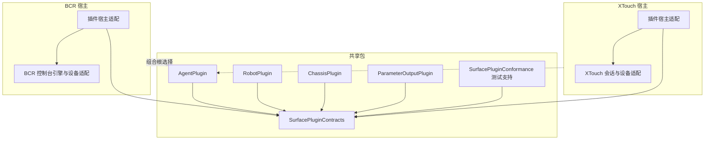

# 领域接口与共享业务插件 TODO

日期：2026-11-12。本文合并了原《通用领域隔离与对外能力接口 TODO》和《共享领域包与宿主插件化草案》
（`DRAFT_SHARED_DOMAIN_PLATFORM.md`，已被本文取代）。

- **第一部分（已交付）**：本仓库的供应方接口与领域隔离。43 项中 41 项完成，C03、C05 等待实体 BCR 复验。
- **第二部分（BCR Agent 已接入）**：共享包合同和 Agent 已实现，BCR B0–B6 已审查通过，B7完成单runtime与新远程工具接线。
  XTouch已接入，跨宿主M1参考序列/同SHA软件验证通过，M2/M3软件实现完成，远端发布与实机仍未完成。工作区总指导是决定与排期的权威。

范围决定见 [ADR 0001](docs/adr/0001-provider-domain-boundaries.md)，能力盘点见
[供应方能力盘点](docs/provider-capability-inventory.md)，既有待办与实机记录见 [TODO.md](TODO.md)、
[ROADMAP.md](ROADMAP.md)。

编号：第一部分使用 G / DM / I / C / RB / V / A / M；第二部分使用 D/U（工作区已定事项/用户待办）、S（阶段任务）、X（验收）。
这些前缀与 ROADMAP 的 R1–R8、TODO 的 D3 / HW 无关。

---

# 第一部分：供应方接口与领域隔离（已交付）

各项的完整要求见 git 历史中本文件的上一版本；适用范围、验证数量和证据定位见
[验收记录](docs/PROVIDER_ACCEPTANCE.md)，合同见 [Provider API 1.0](docs/PROVIDER_API.md)，
发布件接线见 [Quickstart](docs/PROVIDER_QUICKSTART.md)。

## 仍然有效的约束

- 具体业务的工件、流程、审批、部署绑定和控件业务含义由消费方维护，不进入本仓库的领域实现。
- 实机验证（TODO 第 1 节，ROADMAP R1）仍是控制台领域的前提；Mock 结论不能先行写入对外合同。
- 真实执行器接入受 TODO 第 6 节约束：独立停机方案评审之前不得连接。
- 正式发布、版本标签仍需单独授权。

## 条目状态

| 组 | 条目 | 状态 |
| --- | --- | --- |
| 前置决定 | G01 范围、G02 首个消费方、G03 运行形态、G04 网络范围、G05 传输集合 | 全部确认，见 ADR 0001 |
| 接口合同 | I01 能力清单、I02 版本化 Schema、I03 标识/单位/来源、I04 状态机、I05 控制权与重放、I06 快照与事件、I07 独立启动 | 全部完成 |
| 领域边界 | DM01 盘点、DM02 target 边界、DM03 独立状态、DM04 共享资源合同、DM05 示例与保护规则外移、DM06 Agent 独立、DM07 入口共用应用服务 | 全部完成 |
| 控制台 | C01 发现/映射/学习/反馈、C02 有界输入事件流、C04 控件只映射通用参数 | 完成 |
| 控制台 | **C03** 编码/步进/阈值反馈规则 | **未完成**：自动测试通过，依赖 HW2、HW3 实测 |
| 控制台 | **C05** 断开/重连/换映射后的代次与反馈 | **未完成**：软件测试通过，依赖 HW4 实测 |
| 机器人 | RB01–RB05 | 完成；仅 simulation 参考六轴模型，RB05 结论为原生协议 unsupported |
| 底盘 | V01–V05 | 完成；仅 simulation Ackermann 模型 |
| 黑盒交付 | A01–A05 | 完成；原生回读、实体输入及断插标记 pending |
| 增量整理 | M01–M04 | 完成 |

- [ ] C03 实体复验（HW2、HW3）。Relative / NRPN 仍未实机资格化。
- [ ] C05 实体复验（HW4）。

第二部分的任何迁移都不得改变 C03、C05 所依赖的行为；这两项在迁移期间保持未勾选，直到实机复验。

---

# 第二部分：共享业务插件

## 1. 目标与完成定义

同一份业务插件源码、同一个发布版本，可以被 BCR 宿主和 XTouch 宿主分别装配并运行，
宿主之间没有源码依赖，插件不认识任何一种控制器。

“业务插件”指控制器之外、赋予控件含义的模块，按现有代码分为三类：

| 类别 | 现有实现 | 与控制台的关系 |
| --- | --- | --- |
| 动作与状态型 | Mock Agent（两个仓库各有一份）、Codex 会话 | 按键触发动作，状态点亮指示灯 |
| 设备模拟型 | 参考机器人、Ackermann 底盘（仅 BCR） | 主要经远程接口调用；向控制台暴露状态和少量动作 |
| 参数消费型 | OSC / JSON 输出与运动安全门（两个仓库各有一份）、机械臂示例参数集 | 读取参数值，声明参数定义与保护规则 |

里程碑：

- **M1**：Agent 插件在两个宿主中用同一版本运行（S1–S3）。这一步证明合同可行，是后续工作的前提。
- **M2**：机器人、底盘、参数输出迁入并在两个宿主中可装配（S4）。
- **M3**：两个宿主对同一插件暴露同一组远程工具（S5）。

## 2. 对原草案的调整

原草案的边界原则大多保留，下列几处按代码现状改了方向：

1. **共享的窄腰是插件合同，不是控制台引擎。** 原草案把“通用控制台领域”（参数、绑定、输入解释、反馈意图）
   放在最前面抽离。两个引擎差别很大：BCR 有 108 个控件、Quick Learn、相对编码、14 位 NRPN、页面与宏、
   反馈调度；XTouch 有 A/B 层、触摸所有权、电机门禁、观测失效。合并引擎风险最高，
   而且共用插件并不需要它。引擎、绑定配置、反馈调度留在各自宿主；是否共享留到 S6 评估。
2. **只统一参数的“定义与取值规则”。** 插件需要声明参数，所以参数描述和量化规则必须一致（见 D3）。
   这比共享整个引擎小得多，也足够。
3. **补上原草案缺失的宿主—插件接口。** 原草案的 `ResourceService` 提供“领域类型化命令”，
   这要求宿主认识每个领域的类型，等于每加一个插件就要改两个宿主。本文定义统一的控制台面
   （参数、动作、指示灯，见第 4 节）；领域自己的类型化 API 只给组合根和远程绑定使用。
4. **插件核心是纯值类型状态机。** BCR 的领域服务是 `@MainActor` 类加观察者回调，XTouch Core 是
   `mutating` 值类型且必须能在 Linux 上测试。统一为可注入时间的值类型，输入进、更新出，无回调、无异步。
   有 I/O 的部分（进程管理、套接字、Keychain）留在宿主适配器。
5. **运行时、MCP、HTTP 的抽取推迟到 M1 之后。** 原草案一次规划 11 个 target。XTouch 的 MCP 是 225 行、
   3 个工具，BCR 是完整的 Provider 1.0 合同；在合同被两个宿主验证之前抽取通用运行时没有依据。
   首版只建实际用到的 target。
6. **阶段顺序改为纵向切片。** 原顺序是“合同 → 控制台抽离 → BCR → XTouch → 可选领域”，
   共用插件要到第五阶段才出现。现在第一个切片就是“一个真实插件跑在两个宿主上”。

保留不变的原则：独立仓库、中性命名；SwiftPM 静态组合，不做动态库、代码下载或热替换；
领域之间不互相导入；不发布 re-export 全部产品的总入口；设备协议与硬件保护留在设备适配器；
旧配置与旧接口的兼容翻译留在各自宿主。

## 3. 现状对照（实施时必须处理的差异）

| 项 | BCR2000Dev | XTouchCompactDev | 共享包的取法 |
| --- | --- | --- | --- |
| 参数 ID | `ParameterID` 结构体，JSON 为单个字符串 | `String` | 类型化 ID，JSON 仍为单个字符串，两端旧文件可读 |
| 参数种类 | `kind: continuous / toggle` | `isSwitch: Bool` | `kind` 枚举 |
| 步长 | `step: Double?`，0锚点/较低平分 | 旧step=0保shape，取值已对齐0锚点/较低平分 | 见 D3 |
| 默认值 | 缺省为 `minimum` | 缺省为 0 | 描述中必须显式给出 |
| 写入保护 | `agentWritable` + `externallyProtected` | 两字段独立，新字段仅v2；普通旧v1原shape | 两个字段都保留 |
| Agent 状态 | 共享7态，旧Date/name/Codable投影 | 共享7态，legacy API薄投影 | 采用 7 种状态机 |
| Agent 指示 | 同值兼容属性已移设备适配扩展，状态alias共享 | `ButtonLight` off/on/blink | 插件给语义状态，设备适配器决定呈现 |
| 槽位 | `AgentSlotID` legacy类型留基础层；checked构造/插件边界抛错，无precondition | 配置校验限定 1…8 | 数量由插件配置给出，越界返回错误而不是崩溃 |
| Mock 时间线 | 共享advance；MainActor单调owner驱动 | 共享advance；独立host单调owner驱动 | 注入时间 |
| 触发方式 | 生产通用 `triggerAction`；旧case按D8仅兼容 | 旧 `ParameterAction.agent(Int)` 仅兼容；生产触发通用 `ActionReference` | 统一为带命名空间的动作引用 |
| 本地化 | 领域模型直接调用 `L10n.text`，资源在 `BCRFoundation` | 独立本地化模块，Core 不含文案 | 共享包只给稳定键与代码，文案由宿主提供 |
| 错误 | `ProviderDomainError(code, message)` 与本地化枚举并存 | 枚举 | 稳定代码加结构化字段 |
| 并发模型 | `@MainActor final class` 加观察者 | `Sendable` 值类型 | 值类型 |
| 平台 | macOS 14+ | Core 必须可在 Linux 测试 | 纯逻辑可在 Linux 构建测试 |
| 远程接口 | 旧Provider1.0不变 +共享surface_ | 旧3工具不变 +同schema的surface_ | 共用显式typed绑定/有界journal |
| 输出与安全门 | 共享核心+Date/地址/文案薄投影 | 共享完整gate，缺可信遥测明确拒发 | 独立heartbeat/actual/off-on，OSC float32，JSON double |
| 装配 | 唯一runtime，注册路由驱动旧Provider/GUI/新tools | 唯一registry，UI/时钟/remote同值 | 组合根注册，运行器不写 `switch domain` |

当前协作边界：用户已恢复XTouch并行接入；两个宿主各自只改当前授权检出，不读写旧检出。
两个宿主不依赖彼此源码。共享包是独立仓库；已授权的本地路径覆盖不属于额外宿主 clone。
BCR 本阶段每任务本地提交，不推送/标签/远端创建，覆盖原默认提交后推送规则。

## 4. 架构



### 4.1 代码归属

| 归属 | 包含 | 不包含 |
| --- | --- | --- |
| `SurfacePluginContracts` | 插件清单、参数描述与取值规则、动作与指示灯描述、输入/更新类型、来源、结构化错误、JSON 值 | 控件布局、MIDI、领域状态、本地化资源、可变全局状态 |
| 各业务插件 | 本领域状态机、命令、快照、参考模型 | 其他插件、宿主类型、平台框架、套接字、文件路径 |
| `SurfacePluginConformance` | 所有插件和两个宿主共同运行的一致性检查 | 产品代码不依赖它 |
| BCR 设备适配 | 实体布局、Quick Learn、编码器模式、反馈编码与调度、原生诊断、设备 Mock | 不因迁移改变已学习映射，不猜设备预设 |
| XTouch 设备适配 | 出厂 Standard MIDI 映射、层、触摸、电机、灯光编码、设备 Mock | 保留触摸禁驱动、显式召回、观测失效规则 |
| 两个宿主各自 | 控制台引擎与绑定配置、插件宿主适配、GUI、偏好、Keychain、路径、日志、打包、具体 Agent 后端进程 | 不进入共享包 |

共享包不预设设备都通过 MIDI 接入，也不包含任何 7 位值域的假设。

### 4.2 控制台面：参数、动作、指示灯

插件对宿主只暴露三种东西，宿主的引擎只认识这三种：

- **参数**：插件声明定义（ID、名称键、分组、单位、范围、默认值、种类、步长、写入保护）。
  参数值仍然由宿主的参数存储持有，这是两个仓库现有的“软件参数是唯一事实来源”规则；
  插件收到变更通知，也可以带来源地请求写入。
- **动作**：一次性触发，例如 Agent 主操作。绑定引用 `插件 ID / 动作 ID` 加可选索引。
  动作是否存在、索引是否有效、调用方是否有权限，执行前由插件和宿主分别检查。
- **指示灯**：插件给出语义状态（例如 idle / queued / active / attention / done / stopped / fault）
  和可选进度。呈现方式由设备适配器决定：BCR 映射为 LED 或灯环的 7 位值，XTouch 映射为 off / on / blink。

插件自己的类型化 API（例如机器人的关节运动命令和控制权证明）保持为普通的 Swift 公共接口，
由组合根和 S5 的远程绑定使用，不经过控制台面，也不退化成 JSON 万能对象。

### 4.3 接口草图

以下概述已稳定的合同；精确 API 以 `SurfacePlugins` README 和公开源码为准：

```swift
public protocol ControlPlugin: Sendable {
    var manifest: PluginManifest { get }        // 稳定 ID、插件版本、合同版本、来源
    var surface: SurfaceDescriptor { get }      // 参数、动作、指示灯的声明
    mutating func handle(_ input: PluginInput, at time: PluginTime) throws -> PluginUpdate
    func snapshot() -> PluginSnapshot           // 只读；读取不触发动作
}

public enum PluginInput: Sendable {
    case start, stop, advance
    case invoke(ActionReference, origin: InputOrigin)
    case parameterChanged(ParameterID, Double, origin: InputOrigin)
}

public struct PluginUpdate: Sendable {
    public var parameterWrites: [ParameterWrite]
    public var indicators: [IndicatorID: IndicatorState]
    public var events: [PluginEvent]
}
```

规则：

- `time` 是注入的单调秒数。共享包里不出现 `Date.now`、`Task.sleep` 或定时器。
- `handle` 同步、确定：相同的输入序列和时间给出相同的更新。
- 一个插件类型可以创建多个实例。插件 ID、实例 ID、配置代次、控制权代次是不同的字段，不合并成一个字符串。
- `InputOrigin` 区分硬件输入、界面操作、远程写入。它描述产生路径，不代表人的身份或业务审批。
  BCR设备来源不能批准真实Codex审批，由原宿主审批边界保持；Mock维持允许设备批准，插件亦可配置interfaceOnly策略。
- 停止：`stop` 之后拒绝新的写入并撤销控制权；涉及运动的插件必须先完成停止过程再报告已停止，
  停止失败要呈现结果，不能标记为成功。
- 错误使用稳定代码。至少区分：参数无效、能力不支持、无权限、控制权过期、代次不匹配、未初始化、结果未知。

### 4.4 宿主适配

每个宿主写一个插件宿主适配，职责相同、实现各自：

- 在组合根显式列出要装配的插件；先校验 ID 冲突、合同版本、参数与动作命名，全部通过后再生效，
  失败不留下可调用的半注册状态。
- 把自己的绑定类型翻译成动作引用：BCR 的 `agentPrimaryAction(AgentSlotID)`、XTouch 的 `.agent(Int)`。
  磁盘上的旧配置格式保持可读，翻译放在宿主的配置适配器里。
- 把指示灯状态翻译成本设备的反馈。XTouch 的触摸保护仍在最终发送边界检查；
  启动、切层、重连、载入配置都不因为插件更新而获得推子召回权限。
- 由宿主的 `@MainActor` 模型持有插件实例并驱动时间，不依赖窗口刷新。
- 发送成功只表示传输层接受，不作为物理到位的观测。

## 5. 已定事项与待处理事项（取代旧 P01–P06）

跨仓决定以父工作区 `AGENTS.md` 第 4、5 节为准；本文同步当前设计，不另设确认门槛。

| 编号 | 决定 |
| --- | --- |
| D1 | 包/目录 `SurfacePlugins`；targets `SurfacePluginContracts`、`SurfacePluginConformance`、`AgentPlugin`，后续各业务插件独立产品 |
| D2 | JSON锁提交remote+完整revision；stdlib/Git物化到build/dependencies/SurfacePlugins，清单只读验证该固定路径不联网。SOURCE仅获取已提交对象，旧PATH仅获取兼容 |
| D3 | BCR 参数基线：可选step、0锚点网格、包含端点、平分取较小值、toggle中点分界；XTouch后续对齐 |
| D4 | 共享七态转换表，可配置槽位默认8，越界错误；Mock改注入时间 |
| D5 | BCR逐值0/40/127/96/72/20/8，XTouch running/on、waitingApproval/blink、其余off；呈现留各宿主 |
| D6 | 每任务仅本地Conventional Commit，不push/tag/创建远端 |
| D7 | 各仓测试记录数量；硬件未连接，不能宣称实机已验证 |
| D8 | BCR旧枚举case/callback和无注入fallback仅为兼容；生产注入配置适配的通用动作/指示绑定，storage只IndicatorID；不复制整个引擎。新增triggerAction要求旧穷举switch补case，保留旧case构造/pattern/方法行为 |
| D9 | build受管输入不是额外开发克隆；stdlib/Git管理器检查归属/dirty/SHA/symlink，原子物化，不reset外部source；B/C helper逐字相同、无FreeCM依赖 |
| D10 | 本轮完成两宿主M1/M2/M3软件与S6收敛/发布准备；不连接真实执行器，不push/tag |
| D11 | 独立心跳/新鲜实际值/off-on完整共享gate；无可信遥测拒发，不用last-sent或request伪造actual |
| D12 | XTouch独立externallyProtected仅新v2防旧App忽略；旧v1原shape，BCR格式不变 |
| D13 | 仅OSC Float32初始/重seed必须actual精确可表示；失败invalidActual+ID停帧，不epsilon/改actual；JSON类按Double |

U1：远端已有初始main，共享实现尚未推送；当前锁定commit从本地Git获取，不依赖0.1.0标签，推送/发布等用户决定；U2：用户已恢复本工作区XTouch接入，旧检出不读写；
U3：按本轮完成全部计划，XTouch机器人/底盘/输出均可显式装配，默认关闭可选模拟器；U4：三个仓库统一MIT/NorthBoundWisdom，已确定。

## 6. 阶段任务

每个任务一个提交（Conventional Commits），提交正文写明跑过的检查和没有验证的部分。
“软件检查通过”和“实体设备验证通过”分开记录，后者未做就保持未勾选。

### S0 盘点（历史证据已收敛）

- [x] S0-1 差异/共同语义与兼容基线已落实于本第3节及共享docs/output-differences.md、simulation-error-mapping.md、consolidation.md；参数D3与Agent转换矩阵由共享单测锁定。
- [x] S0-2 两宿主逐符号/层引用盘点已写工作区reports/B.md的B0及reports/C.md的C0，作为后续改动范围。
- [x] S0-3 两宿主原始测试数量已记录：BCR356，XTouch130（含9 XCTest，不仅SwiftTesting121）；后续完整检查均不减少。

### S1 合同包

- [x] S1-1 建仓库与 `SurfacePluginContracts`：第 4.2、4.3 节的类型，参数描述与取值规则按 D3。
  只依赖 Foundation，无全局可变状态，无 `L10n`。
- [x] S1-2 参数取值规则的测试：从 BCR 的 `SurfaceConfigurationTests`、`EncoderPrecisionTests` 中
  与设备无关的用例移植，覆盖端点、平分、toggle、非有限值、无法表示的步长。
- [x] S1-3 `SurfacePluginConformance`：任意插件都要通过的检查，包括确定性重放、`snapshot` 无副作用、
  未知动作与越界索引返回错误、`stop` 之后拒绝写入、声明的参数与指示灯 ID 唯一且带命名空间。
- [x] S1-4 用两个虚构布局的测试宿主（一个只有按键和 7 位灯环，一个有层和三态灯）驱动同一个测试插件，
  证明合同不含布局假设。
- [x] S1-5 边界检查脚本：禁止导入 AppKit、SwiftUI、CoreMIDI、Network、Combine、Security；
  禁止出现宿主名、设备名和具体下游业务名。边界检查已实现；macOS本机与Root独立官方Swift6.0.3 Linux/aarch64验证通过（共享最终103测试），双平台CI已配置但远端未执行。

完成标准：包可独立构建测试；没有宿主导入；没有固定控件数量、槽位数量或 7 位值域。

### S2 Agent 插件与 BCR 接入

- [x] S2-1 `AgentPlugin`：状态机取自 `BCRAgentDomain/AgentModels.swift`，去掉 `L10n`、`Date.now` 默认值
  和 `feedbackValue`；Mock 时间线从 `ConsoleViewModel+Agents.swift` 的 `Task.sleep` 序列改写为注入时间的步进，
  阶段与进度值保持一致。通过 `SurfacePluginConformance`。
- [x] S2-2 BCR 插件宿主适配：注册、动作引用翻译、指示灯到 7 位值的映射（D4/D5 的逐值表）。
- [x] S2-3 生产引擎按中性bindings触发通用动作，反馈只按指示ID存储。旧配置仍可解码、翻译在配置适配器。
  按D8保留旧enum case/callback和未注入fallback，仅供旧调用；新增case的穷举switch限制已文档化，回归测试保留。
- [x] S2-4 `BCRAgentDomain.AgentRunState` alias共享enum，Date/name/Codable/旧错误留compat-only包装，唯一转换表委托共享allows；
  `BCRAgentCore`旧成员调用与pattern保留（穷举switch例外见D8）。Codex路径及设备禁止真实审批的断言保持。
- [x] S2-5 更新 `configs/check_domain_boundaries.py`、ADR、`AGENTS.md`。

BCR证据：原始356、B0锁定359、B1为369、B2为374、B3/B4为376、B5为380、B6为384、B7为396、B8为399、B9为403、B10为408；最终自包含产物原样14组Provider黑盒通过，新工具现代/2025 HTTP协议也通过。
B0–B7最终检查与审查见工作区 `reports/B.md` / `reports/REVIEW.md`；共享包合同可用，跨宿主M1同SHA/同参考序列软件验证通过。

完成标准：BCR 既有测试数量不减少且全部通过；Provider 1.0 的工具名、错误语义和事件顺序不变；
C03、C05 涉及的反馈路径没有行为变化。

### S3 XTouch 接入同一版本（M1）

- [x] S3-1 XTouch 插件宿主适配：注册、`.agent(Int)` 的翻译、指示灯到 `ButtonLight` 的映射。
- [x] S3-2 用 `AgentPlugin` 取代 `MockAgents`；`CompactSession.updateAgentLights` 改为接收指示灯状态。
  旧v1配置原shape保留；新独立保护字段按D12使用v2，仍拒绝载入BCR配置。
- [x] S3-3 按 D3 对齐参数取值规则，列出行为变化并补测试。
- [x] S3-4 Core 测试保持可在 Linux 运行；更新 XTouch 的 `AGENTS.md` 中关于外部依赖的规则。

完成标准：两个宿主依赖共享包的同一个精确版本；各自独立检出即可构建，不需要对方的源码；
XTouch 既有测试全部通过，触摸、召回、重连相关测试没有改动断言。

### S4 其余插件（M2，每个插件独立完成）

- [x] S4-1 `RobotPlugin`：迁移 `BCRRobotDomain` 和 `BCRSimulationKernel` 的 `DeviceControl`。
  控制权、代次、序号、TTL、过期拒绝、目标值与实际值分离的行为保持不变，明确标记 simulation。
- [x] S4-2 `ChassisPlugin`：迁移 `BCRChassisDomain`。与机器人不共享可变状态，只共用控制权工具。
- [x] S4-3 BCR 的 `ProviderApplication` 改为经注册表驱动，去掉 `domain: String` 分支；Provider 1.0 黑盒场景原样通过。
- [x] S4-4 `ParameterOutputPlugin`：先写两份 `MotionSafetyGate` 与 OSC 编码的差异表，再合并为一个纯核心；
  套接字与凭据留在宿主。不一致之处取更保守的行为，并列出每个宿主的变化。
- [x] S4-5 示例参数集：机械臂示例和它的受保护参数声明作为可显式载入的数据插件；默认配置保持领域中性，
  旧配置迁移后仍受保护。
- [x] S4-6 XTouch 按 U3 的结论装配。

完成标准：任一插件可单独引入，不会带入其他插件；撤销或重置一个实例不影响其他实例的状态、控制权和订阅。

### S5 远程合同共用（M3）

- [x] S5-1 每个插件提供自己的远程绑定 target：工具名、输入输出 Schema、错误映射显式声明，不靠反射生成。
- [x] S5-2 抽取 MCP 工具注册与有界事件日志中确实相同的部分；HTTP 监听、令牌、权限界面留在宿主。
- [x] S5-3 BCR 经兼容适配保持 Provider 1.0 不变；XTouch 现有的 3 个工具保留，新增能力经能力发现开放。
- [x] S5-4 响应丢失、事件缺口、慢读者、过期控制权都有可观察结果；重连不重放有副作用的命令，
  重新取快照不产生输入事件。

### S6 收敛

- [x] S6-1 删除已替换的重复实现和本轮临时桥（含独立PluginRegistry）；保留明确legacy facade。
- [ ] 共享包推送/正式版本发布：按D6等待用户决定，本轮不推送/打标签；固定commit构建不依赖tag。
- [x] S6-2 已评估：本轮不再共享控制台引擎。参数规则/业务核心/remote registry已消除可验证重复；
  BCR的Quick Learn、echo/NRPN/反馈调度与XTouch触摸/召回/层/电机代次具有不同硬件保护，不应为少量兼容绑定代码合并。
  未来出现可逐项对照的新重复再另开计划，不在本任务扩大引擎范围。

## 7. 验收矩阵

- **X1 依赖边界**：只引入 `SurfacePluginContracts` 不会编译任何插件；只引入一个插件不会编译其他插件、
  GUI、CoreMIDI 或网络代码。
- **X2 同源同版本**：两个宿主的JSON锁/实际build物化均为add3c2404e4d2dbe3f9d0861bbda01c013018669；任一宿主在没有另一个宿主源码的机器上可以构建和测试。
- **X3 行为一致**：同一段插件输入序列在两个宿主的适配测试里得到相同的插件快照；
  呈现差异只来自设备适配器的映射表。
- **X4 设备事实**：反馈发送不伪造物理观测；XTouch 触摸时不驱动电机，启动、切层、重连、载入配置不自动召回；
  BCR 不猜设备预设，不改写已学习映射。
- **X5 隔离**：同时装配多个插件和多个实例，停用、撤权或重置其中一个，其余不受影响；注册失败无残留。
- **X6 兼容**：两个宿主的旧配置文件可读且保护标记不丢失；BCR 的 Provider 1.0 黑盒场景通过；
  XTouch 的 MCP 工具行为不变。
- **X7 证据分离**：每个阶段分别记录软件检查与实体设备验证，模拟结果不替代实机条目。

## 8. 审查清单（每个提交都会查）

1. 共享包里没有宿主名、设备名、控件数量、槽位数量、MIDI 值域、`L10n`、`Date.now`、定时器或平台框架。
2. 插件之间没有导入关系；运行器里没有按插件名分支的代码。
3. 插件核心是值类型，`handle` 同步且确定，测试用注入时间。
4. 每个新的状态转换、动作和指示状态都有针对性的单元测试；迁移来的测试数量不少于原先。
5. 既有行为有意改变时，提交说明列出变化和受影响的配置；没有列出的行为变化视为缺陷。
6. 旧配置的兼容翻译在宿主的配置适配器里，不在共享包里。
7. 失败可见，没有静默回退；没有实机验证的内容不写成已验证。
8. 提交不包含绝对路径、凭据、MIDI 抓包或本地映射；宿主清单仅用固定build/dependencies物化路径，不含本地源码override或绝对路径；manifest只读verify、不获取/联网。
9. XTouch：触摸期间不发电机指令，输入地址与反馈地址、TX 通道与 RX 通道保持分离。
10. BCR：`BCRAgentCore` 的兼容导出仍可用，边界检查脚本通过，C03、C05 的状态没有被改动。
