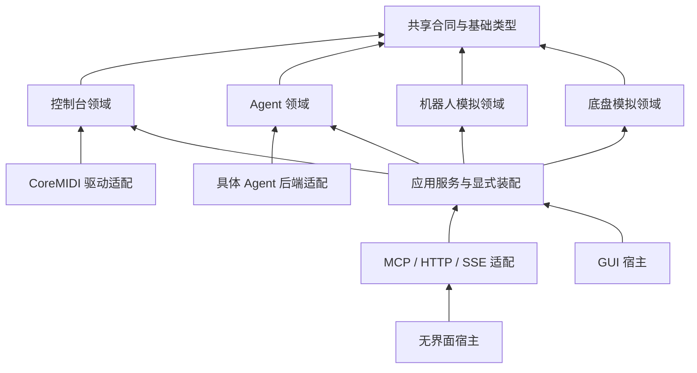

# ADR 0001：独立领域与供应方接口

日期：2026-11-11。状态：范围决定已由用户确认；实现与逐项证据随 `TODO_DOMAIN_INTERFACES.md` 更新。

## 用户确认的范围（G01–G05）

- G01：控制台、机器人模拟器和底盘模拟器位于本仓库，作为可独立使用的可选模块。
- G02：首个消费方为外部 Pipe 集成项目。首批链路为控制台输入/反馈、机器人关节运动/停止、
  Ackermann 底盘速度/转向/停止。其业务对象、流程、审批及具体控件映射留在消费方仓库。
- G03：macOS GUI 与独立无界面服务共用应用服务及领域实现；不依靠 GUI 操作完成接线。
- G04：首批只绑定本机 IPv4 回环；不新增局域网监听、真实执行器接入或设备预设写入。
- G05：首批为基于 HTTP 的 MCP 调用及 SSE 事件；其他现有输出适配器保留兼容，
  厂家原生机器人/底盘协议不作为本批支持能力。

## 依赖与职责

共享模块只承载 JSON、标识、时间/来源合同和本地化等基础类型。控制台、Agent、机器人和底盘
分别拥有状态、生命周期、错误和测试；机器人/底盘实现不依赖控制台参数、MIDI 或 Agent。
具体 Agent 后端、设备驱动、MCP、持久化及 UI 均属于适配器或应用装配。

模块以 Swift target 和依赖检查落实。先拆 Agent/具体后端及共享类型，再拆控制台与外围设施。
旧 `BCRAgentCore` 可保留为兼容导出入口，新领域不得反向依赖该兼容入口。
历史配置兼容逻辑属于明确的迁移适配器；机械臂示例与旧示例参数保护不作为通用领域常量。

## 状态隔离

控制台连接/映射代次、Agent 会话、机器人执行、底盘执行分别管理。重置一个模拟器只影响本设备。
首批机器人与底盘拥有独立时钟/控制权与故障状态，不共享可变世界；未来联合世界另订协调合同。
通用设备能力可在没有 Agent 后端、没有实体控制台时运行。权限按能力划分，不继承 Agent 权限。

## 第一批模拟保真范围

机器人采用明确配置的参考关节链，提供已初始化的关节状态、正向位姿与有界关节运动；不提供 IK、
真实厂家程序执行或碰撞资格。底盘采用明确轮距/轴距/转向限位的 Ackermann 模型，提供积分运动及
停止反馈；不提供侧移或原地旋转。两者均显式标注 simulation，目标与实际推进状态分开。

## 交付与验收

合同、Schema 和公开客户端示例随产物发布。黑盒验收只启动发布的可执行文件并调用公开接口，
不导入 Swift 内部类型、不指定本仓库源码路径。分别记录软件、Mock、设备回读和人工输入证据；
未完成的实机条目保留未验，不用模拟结果替代。正式发布、真实执行器接入仍需另外授权。
