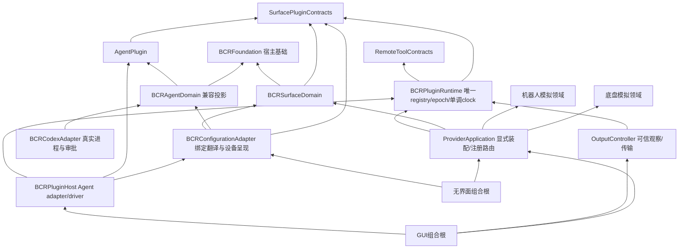

# ADR 0001：独立领域与供应方接口

日期：2026-11-12。状态：范围决定已由用户确认；实现与逐项证据随 `TODO_DOMAIN_INTERFACES.md` 更新。

## 用户确认的范围（G01–G05）

- G01：控制台、机器人模拟器和底盘模拟器位于本仓库，作为可独立使用的可选模块。
- G02：首个消费方为外部 Pipe 集成项目。首批链路为控制台输入/反馈、机器人关节运动/停止、
  Ackermann 底盘速度/转向/停止。其业务对象、流程、审批及具体控件映射留在消费方仓库。
- G03：macOS GUI 与独立无界面服务共用应用服务及领域实现；不依靠 GUI 操作完成接线。
- G04：首批只绑定本机 IPv4 回环；不新增局域网监听、真实执行器接入或设备预设写入。
- G05：首批为基于 HTTP 的 MCP 调用及 SSE 事件；其他现有输出适配器保留兼容，
  厂家原生机器人/底盘协议不作为本批支持能力。

## 依赖与职责

`BCRFoundation` 承载宿主 JSON/标识/本地化。独立 `SurfacePlugins` 包的合同和插件仅依赖 Foundation，
不含平台、设备、本地化、套接字或真实后端。`AgentPlugin` 是唯一 Mock 七态/时序实现；
`BCRAgentDomain` 仅保留共享状态 alias 与 Date/name/Codable/旧错误兼容投影，转换允许规则委托共享状态机。
机器人和底盘已各自委托共享插件核心，旧本仓库领域保留typed facade/文案映射，无第二份积分算法或控制权状态机，
不依赖控制台参数、MIDI或Agent。旧Provider DTO alias共享同形合同，外层生成实例UUID与每grant新opaque token。

生产 GUI 和无界面 console Session 均注入配置适配器的中性动作/指示绑定，引擎只派发 `ActionReference`，
反馈storage只按 `IndicatorID`。旧 `agentPrimaryAction` 磁盘表示/保护规则和 Provider 1.0 合同不变。
设备呈现的七位值、旧反馈API、命名空间翻译留配置适配器，Quick Learn、映射、调度、反馈最终发送边界仍在宿主。

工作区 D8 为源码兼容保留旧 `ControlTarget.agentPrimaryAction`、`SurfaceEffect.triggerAgent`、
`onTriggerAgent` 及未注入映射时的legacy fallback；它们不是生产业务路径。
新增 `triggerAction` 后，外部无default穷举旧 `SurfaceEffect` 的switch需增加case；旧成员构造、pattern、方法行为保持，
不声称所有消费者源码零修改。此窄例外避免复制整个配置/引擎/会话。
`BCRAgentCore` 继续作为兼容导出入口，新领域不得依赖它。完整依赖/兼容与验证边界见 [共享插件接入](../SHARED_PLUGINS.md)。

每宿主共用一份runtime：Agent/旧Provider模拟器/Output/新surface工具修改同一binding value；typed state与事件原子replace。
旧data结果包裹和Provider1.0 Schema保留，新raw对象直接采用共享schema并按原角色/模拟管理权限和manual模式授权。
clock坏值只允许可信安全撤权/fault使用最后可信时刻；普通写拒绝，不全局悄悄clamp。输出Date观察保age映射到共同单调域，
OSC Float32 seed严格而JSON Double不受无关精度限制。详见 [共享远程工具](../SHARED_REMOTE_TOOLS.md)。

共享包是授权的独立仓库，不是额外宿主clone；JSON锁固定remote/完整commit，Git管理器物化到build依赖目录，清单只读验证固定路径。
SOURCE环境仅供获取已提交对象，不直接编译本地工作树；manager/default build不依赖FreeCM。
联调期间每任务本地提交、不push/tag/创建远端，远端发布时机由用户决定。
历史配置迁移属于适配器；机械臂示例与旧示例保护不作为通用领域常量。

## 状态隔离

控制台连接/映射代次、Agent 会话、机器人执行、底盘执行分别管理。重置一个模拟器只影响本设备。
首批机器人与底盘拥有独立时钟/控制权与故障状态，不共享可变世界；未来联合世界另订协调合同。
通用设备能力可在没有 Agent 后端、没有实体控制台时运行。权限按能力划分，不继承 Agent 权限。

## 第一批模拟保真范围

机器人采用明确配置的参考关节链，提供已初始化的关节状态、正向位姿与有界关节运动；不提供 IK、
真实厂家程序执行或碰撞资格。底盘采用明确轮距/轴距/转向限位的 Ackermann 模型，提供积分运动及
停止反馈；不提供侧移或原地旋转。两者均显式标注 simulation，目标与实际推进状态分开。

## 交付与验收

合同、Schema 和公开客户端示例随产物发布。黑盒验收只启动发布的可执行文件并调用公开接口，
不导入 Swift 内部类型、不指定本仓库源码路径。分别记录软件、Mock、设备回读和人工输入证据；
未完成的实机条目保留未验，不用模拟结果替代。正式发布、真实执行器接入仍需另外授权。
